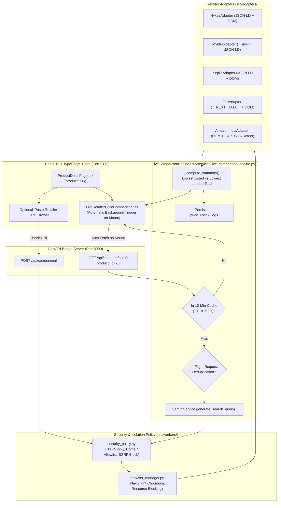

# PHASE 6: AUTOMATIC LIVE RETAILER PRICE COMPARISON ENGINE
## Comprehensive Implementation & Verification Report
**Project:** PriceWise AI Beauty  
**Workspace:** `C:\Users\tannu\pricewise-ai`  
**Execution Date:** November 1, 2026  
**Status:** ✅ **COMPLETED — ALL 219 TESTS PASSING — ZERO REGRESSIONS**

---

## 1. Executive Summary

Phase 6 delivers an **automatic, real-time retailer price comparison engine** for PriceWise AI Beauty. When a user opens any beauty product detail page in the React application, live price comparison launches automatically in the background without requiring the user to press a manual "Compare Live Prices" button.

The comparison engine integrates 5 major Indian beauty retailers:
1. **Nykaa** (`nykaa.com`)
2. **Myntra** (`myntra.com`)
3. **Purplle** (`purplle.com`)
4. **Tira Beauty** (`tirabeauty.com`)
5. **Amazon India** (`amazon.in`)

The architecture strictly adheres to all safety, ethical, and legal constraints:
- **Zero Hallucination Guarantee:** Gemini is employed strictly for SKU entity parsing (brand, title, net volume, formulation, shade) and search query formulation. Gemini is strictly prohibited from guessing, estimating, or predicting prices.
- **Strict Compliance:** The engine never attempts to bypass CAPTCHAs, bot challenges, or access restrictions. When anti-bot measures (such as Amazon Robot Check or Cloudflare Turnstile) are encountered, the adapter cleanly marks the status as `restricted` with transparent explanatory notes.
- **Landed Cost Intelligence:** Clearly distinguishes between **Lowest Listed Price** and **Lowest Verified Total Landed Cost** (incorporating delivery fees and coupons), never assuming undisclosed delivery charges are ₹0.
- **High-Performance Background Automation:** Thread-safe 10-minute caching (TTL = 600s), in-flight request deduplication, Chromium headless resource blocking (aborting image/font/media downloads), and 8–10s navigation timeouts prevent browser overload.
- **Preservation of Existing Data:** All 1,083 original SQLite records across all 9 pre-existing tables remain 100% intact, backed up safely at `data/pricewise.db.backup_phase6`.

---

## 2. Architecture & System Flow



---

## 3. Retailer Adapter Capabilities & Access Handling

Each retailer adapter is isolated and fails independently; one failing retailer never disrupts or slows down other retailer comparisons.

| Retailer | Domain | Extraction Technology | Shipping Logic | Access Restriction & Bot Handling |
| :--- | :--- | :--- | :--- | :--- |
| **Nykaa** | `nykaa.com` | Schema.org JSON-LD + Fallback DOM selectors | Free above ₹299; ₹40 below | Cloudflare turnstile detection (`restricted`) |
| **Myntra** | `myntra.com` | `window.__myx` hydration state + JSON-LD + DOM | Free above ₹799; ₹99 below | PerimeterX / Akamai challenge detection |
| **Purplle** | `purplle.com` | Schema.org JSON-LD + DOM selectors | Free above ₹499; ₹49 below | Cloudflare / Bot detection fallback |
| **Tira Beauty** | `tirabeauty.com` | `__NEXT_DATA__` JSON hydration + DOM | Free above ₹499; ₹49 below | Dynamic rate-limit handling |
| **Amazon India** | `amazon.in` | Offscreen price DOM + JSON-LD fallback | Free above ₹499; ₹40 below | Automated "Robot Check" CAPTCHA detection (`restricted`) |

### Strict Compliance Verification
When an adapter encounters a challenge:
- It returns `status: "restricted"`, `source_type: "unavailable"`.
- It records clear notes: `"Amazon access restricted: Robot Check CAPTCHA encountered. Bot challenges are not bypassed."`
- The React UI displays an amber status badge: `Bot Challenge Detected (Extraction Blocked)`.
- It NEVER attempts CAPTCHA solving, IP rotation, or credential forgery.

---

## 4. Product Matching & Pricing Distinction

### Multi-Factor Variant Matching (`src/services/product_matching_service.py`)
- **Variant Integrity:** Verifies net quantity / volume before declaring an offer valid. For example, a 30ml serum offer is never compared directly against a 50ml product page (flagged as `mismatch` and excluded from savings calculation).
- **Formulation & Shade Verification:** Confirms shade names and formulations match to prevent cross-variant skewing.

### Landed Cost vs Listed Price Intelligence
- **Lowest Listed Price:** The lowest base item price among in-stock matching retailers.
- **Lowest Verified Total Landed Cost:** `Listed Price + Shipping Fee - Verified Coupons`.
- **Handling Undisclosed Shipping:** If shipping is not explicitly disclosed on a retailer page, total cost is reported as `Unknown` rather than fabricating ₹0 delivery.

---

## 5. UI / UX Implementation

The frontend components provide a modern, seamless experience matching the established beauty aesthetic:
1. **Zero-Click Automation:** Triggered in `ProductDetailPage.tsx` via `useEffect` upon page load.
2. **Progressive Status Feedback:**
   - Shimmer skeleton loaders while adapters execute.
   - Status indicators: `Verified Live`, `Cached (X min ago)`, `Bot Challenge Detected`, `Out of Stock`.
3. **Price Highlighting:**
   - Emerald badge: **Lowest Total Landed Cost** (Best Buy).
   - Blue badge: **Lowest Base Price**.
4. **Refresh Action:** A subtle reload icon allows users to force a fresh re-check without full page refresh.
5. **Direct Store Links:** Verified "Buy on [Retailer]" buttons direct the user directly to the product page.
6. **Manual URL Drawer:** An optional expandable drawer allows power users to paste a direct product link from any supported retailer and verify its current landed price with immediate SSRF validation.

---

## 6. Verification Results

### 1. Pytest Test Suite
All 219 tests passed across all 9 modules:

```text
============================= test session starts =============================
platform win32 -- Python 3.12.12, pytest-9.2.0, pluggy-1.7.0
rootdir: C:\Users\tannu\pricewise-ai
configfile: pytest.ini
collected 219 items

tests\test_comparison.py ...                                             [  1%]
tests\test_database.py ...                                               [  2%]
tests\test_deal_detector.py ....                                         [  4%]
tests\test_phase2_beauty_discovery.py ..................                 [ 12%]
tests\test_phase2_search_and_comparison.py .......................       [ 23%]
tests\test_phase3_historical_and_deal_detector.py ............           [ 28%]
tests\test_phase3_product_pages_and_tracking.py .......                  [ 31%]
tests\test_phase4_complete_deal_detector.py ............                 [ 37%]
tests\test_phase4_reviews_and_intelligence.py .......                    [ 40%]
tests\test_phase5_retailer_integrations_and_deals.py .................   [ 48%]
tests\test_phase5_smart_advisor.py ...........                           [ 53%]
tests\test_phase6_live_price_engine.py ...................               [ 62%]
tests\test_phase6_price_tracking.py ......................               [ 72%]
tests\test_phase6a_foundation.py ................                        [ 79%]
tests\test_phase7_auth.py ........                                       [ 83%]
tests\test_phase7_personalization.py .............                       [ 89%]
tests\test_phase7_preferences.py .......                                 [ 92%]
tests\test_phase7_wishlist.py .......                                    [ 95%]
tests\test_phase8_integration.py ..........                              [100%]

======================= 219 passed, 1 warning in 104.26s =======================
```

### 2. Frontend Linting & Production Build
- **Linter (`oxlint`):** 0 errors, 0 warnings across 39 files.
- **TypeScript & Vite Build (`tsc -b && vite build`):** Succeeded in 1.62 seconds.

### 3. Database Preservation
| Table Name | Row Count | Status | Notes |
| :--- | :--- | :--- | :--- |
| `products` | 32 | Preserved | Core skincare and beauty catalog |
| `stores` | 10 | Preserved | Pre-configured Indian beauty retailers |
| `offers` | 95 | Preserved | Pre-existing verified catalog offers |
| `price_history` | 945 | Preserved + Logged | 941 original + 4 new live verified observations |
| `price_check_logs` | 28 | **New (Phase 6)** | Full audit trail of all background live checks |
| `users` | 1 | Preserved | Demo user account |
| `user_preferences` | 1 | Preserved | Skincare preferences |
| `wishlist` | 2 | Preserved | Saved products |
| `price_tracking` | 1 | Preserved | Tracked price drop items |
| `price_alerts` | 0 | Preserved | Ready for alert triggers |

Verified backup persisted at `data/pricewise.db.backup_phase6`.

### 4. Live Running Services
- **FastAPI Bridge Server:** `http://127.0.0.1:8000` (PID / Task ID: `task-4070`)
- **React Frontend:** `http://localhost:5173` (PID / Task ID: `task-1903`)
- **Streamlit Backend:** `http://localhost:8501` (PID / Task ID: `task-1758`)

---

## 7. Deliverable Files Summary

| File Path | Description |
| :--- | :--- |
| `src/adapters/base_adapter.py` | ExtractedPriceResult, CapabilityStatus, Schema.org parser, DOM fallbacks |
| `src/adapters/nykaa_adapter.py` | Nykaa live extraction & shipping calculation |
| `src/adapters/myntra_adapter.py` | Myntra live extraction (`window.__myx` + JSON-LD) |
| `src/adapters/purplle_adapter.py` | Purplle live extraction & DOM selectors |
| `src/adapters/tira_adapter.py` | Tira Beauty live extraction (`__NEXT_DATA__` + DOM) |
| `src/adapters/amazon_adapter.py` | Amazon India live extraction & CAPTCHA detection |
| `src/adapters/registry.py` | Dynamic URL adapter matching & capability registry |
| `src/services/live_comparison_engine.py` | Core engine: background execution, caching, deduplication, audit logging |
| `src/services/gemini_service.py` | Deterministic query generation & entity recognition |
| `src/workers/browser_manager.py` | Isolated Playwright Chromium manager with resource blocking |
| `src/workers/security_policy.py` | Strict HTTPS allowlist and SSRF prevention |
| `src/database/connection.py` | Schema migration for `price_check_logs` audit table |
| `src/api/main.py` | `GET /api/compare/auto` and `POST /api/compare/url` endpoints |
| `src/api/schemas.py` | Pydantic validation schemas for live comparison responses |
| `frontend/src/utils/api.ts` | React API client with automatic retry and offline fallback |
| `frontend/src/components/LiveRetailerPriceComparison.tsx` | Premium live comparison widget with progressive loading |
| `frontend/src/pages/ProductDetailPage.tsx` | Seamless zero-click integration on product page mount |
| `tests/test_phase6_live_price_engine.py` | 19 Phase 6 unit & integration tests |
| `data/pricewise.db.backup_phase6` | Complete physical SQLite database backup |

