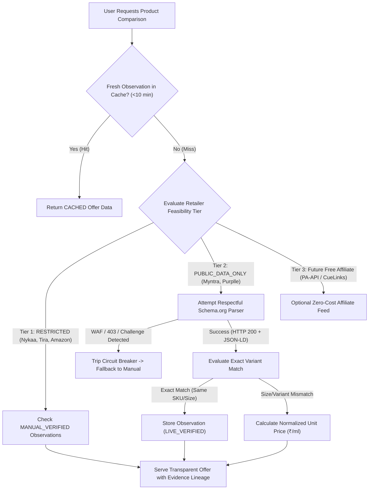
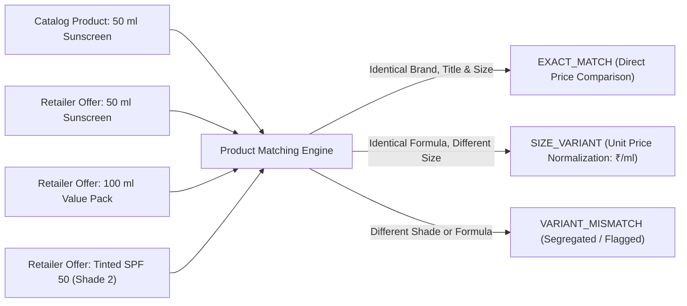
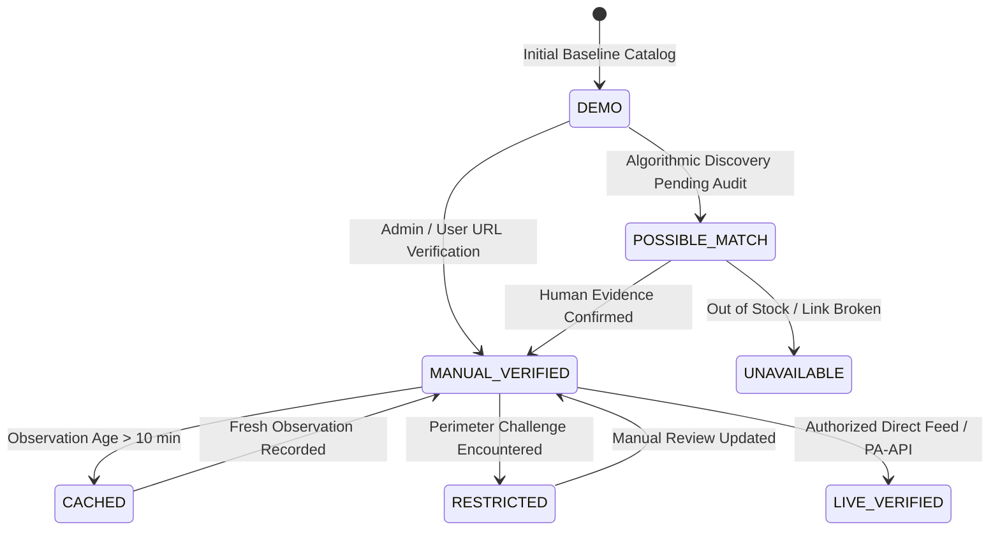

# PriceWise AI — Phase 11A: No-API Architecture & Implementation Plan

**Project:** PriceWise AI Beauty Intelligence & Price Comparison  
**Phase:** Phase 11A (No-API Retailer Price Access & Feasibility Audit)  
**Document:** Technical Architecture & Implementation Blueprint  
**Status:** DRAFTED & READY FOR USER REVIEW  

---

## 1. Architectural Vision & Operating Principles

The primary mandate of PriceWise AI's data infrastructure is to deliver genuine, trustworthy beauty price comparison **without purchasing five separate retailer APIs, without paid commercial proxy networks, and without violating website security perimeters**.

### Non-Negotiable Boundaries:
1. **Zero Paid API Subscriptions:** The architecture requires ₹0 in recurring third-party API fees.
2. **Zero Access Control Bypasses:** The system strictly halts automated requests upon encountering WAF blocks (Akamai, Cloudflare, Amazon Robot Check, HTTP 403, CAPTCHAs).
3. **Truth in Evidence:** A price is NEVER promoted to `LIVE_VERIFIED` or `MANUAL_VERIFIED` without cryptographic source lineage stored in `evidence_references`. Demo records remain transparently marked as `DEMO`.
4. **Exact Variant & Unit Price Integrity:** 30 ml and 100 ml products are never directly compared without normalized unit pricing (₹/ml or ₹/g).

---

## 2. High-Level System Architecture

The architecture employs a **Tiered Hybrid Intelligence Engine** that gracefully falls back across three sanctioned data acquisition channels:



---

## 3. Core Architectural Components

### 3.1 Shared Page Fetcher & Perimeter Sensor (`SharedPageFetcherService`)
A single, reusable fetching service responsible for all outbound HTTP interactions:
- **Per-Domain Rate Limiter:** Enforces strict compliance with published crawling guidance:
  - Default rate: Maximum **1 request per 60 seconds per domain**.
  - Exponential backoff with jitter on HTTP 429 (`Too Many Requests`).
- **WAF & Challenge Detection (Passive Sensor):**
  - Evaluates HTTP response codes and initial bytes.
  - Automatically recognizes WAF signatures:
    - Akamai Ghost Reference Errors (`<TITLE>Access Denied</TITLE>`)
    - Cloudflare Turnstile / Challenge-running headers (`cf-ray`, `503 Service Unavailable`)
    - Amazon Robot Check CAPTCHA pages (`/errors/validateCaptcha`)
  - **Circuit Breaker Action:** When a challenge or 403 is detected, the circuit breaker for that retailer transitions to `OPEN` for 24 hours. **Zero retry loops, zero proxy rotation, zero headless evasion.** The engine immediately falls back to manual verification.

### 3.2 Modular Retailer Parsers (`src/adapters/`)
Each retailer maintains a dedicated, decoupled parser plugin inheriting from `BaseRetailerAdapter`:
1. **`NykaaAdapter`:**
   - Active status: `RESTRICTED` (WAF blocked).
   - Operational mode: `MANUAL_ONLY` fallback.
   - Parser capability: Pre-configured with Schema.org JSON-LD and regex fallback for authorized staging / offline HTML snapshots.
2. **`MyntraAdapter`:**
   - Active status: `PUBLIC_DATA_ONLY`.
   - Operational mode: Static HTTP extraction of Schema.org `Product` JSON-LD (`name`, `price`, `priceCurrency: INR`, `availability`).
   - Dynamic widget avoidance: Does not invoke `ajaxPDPCouponWidget` or pincode delivery widgets disallowed in `robots.txt`.
3. **`PurplleAdapter`:**
   - Active status: `PUBLIC_DATA_ONLY`.
   - Operational mode: Reads OpenGraph meta tags (`og:price:amount`, `og:availability`); falls back to manual verification due to SPA hydration requirements and Terms of Use restrictions.
4. **`TiraAdapter`:**
   - Active status: `RESTRICTED` (Reliance Akamai WAF).
   - Operational mode: `MANUAL_ONLY` fallback.
5. **`AmazonAdapter`:**
   - Active status: `RESTRICTED` (Automated scraping gated by Robot Check).
   - Operational mode: `MANUAL_ONLY` fallback or free Amazon Associates PA-API integration.

---

## 4. Exact Product Matching & Variant Integrity Engine

A critical requirement of PriceWise AI is preventing misleading price comparisons caused by package size or formulation discrepancies.



### 4.1 Variant Classification Rules:
1. **`EXACT_MATCH`:**
   - Brand, product title, and net volume/weight match within 2% tolerance (e.g. 50g vs 50ml for identical emulsion density).
   - Directly compared in the main Price Comparison table.
2. **`SIZE_VARIANT`:**
   - Same brand and active formula, but distinct pack volume (e.g., 30ml vs 50ml vs 100ml).
   - **Mandatory Normalization:** The system calculates and displays:
     $$\text{Normalized Unit Price} = \frac{\text{Observed Price}}{\text{Net Volume/Weight}} \quad (\text{₹/ml or ₹/g})$$
   - Marked with an explicit badge: `Size Variant: 100 ml (₹9.30/ml vs Reference ₹9.80/ml)`.
3. **`SHADE_VARIANT`:**
   - Applicable to makeup (foundations, concealers, lipsticks).
   - Matched against the specific user skin depth/undertone or clearly labeled (e.g. `Maybelline Fit Me #128 Warm Nude`).
4. **`POSSIBLE_MATCH`:**
   - Brand matches but title similarity is between 65% and 85%.
   - **Never marked as an exact verified match.** Flagged with a user review prompt: *"Possible Alternative — Verify formulation before purchasing."*

---

## 5. Source Evidence & Verification Lifecycle

Every single price point displayed in PriceWise AI must adhere to the 8-state verification lifecycle:



### 5.1 Verification Record Schema (`evidence_references` Table):
Every price modification creates an immutable evidence row in SQLite:
```sql
CREATE TABLE IF NOT EXISTS evidence_references (
    id INTEGER PRIMARY KEY AUTOINCREMENT,
    product_id INTEGER NOT NULL,
    retailer_name TEXT NOT NULL,
    store_id INTEGER NOT NULL,
    observed_price REAL NOT NULL,
    mrp REAL,
    net_quantity TEXT,
    variant_detected TEXT,
    availability TEXT DEFAULT 'In Stock',
    observation_timestamp TIMESTAMP DEFAULT CURRENT_TIMESTAMP,
    collection_method TEXT NOT NULL, -- 'manual_url_snapshot', 'user_submission', 'schema_org_json_ld'
    evidence_url TEXT NOT NULL,
    evidence_hash TEXT NOT NULL,     -- SHA-256 of (URL + Price + Timestamp)
    verification_status TEXT NOT NULL, -- 'MANUAL_VERIFIED', 'LIVE_VERIFIED', 'DEMO'
    verified_by_user_id INTEGER,
    validation_notes TEXT,
    FOREIGN KEY (product_id) REFERENCES products(id),
    FOREIGN KEY (store_id) REFERENCES stores(id)
);
```

---

## 6. Manual Price Verification Workflow (Primary Operational Tier)

Because 3 out of 5 retailers actively block automated access at the WAF perimeter, the **Manual Price Verification Workflow** serves as PriceWise AI's primary operational engine:

### 6.1 User & Admin Submission Pipeline:
1. **Submission Interface:**
   - Users or administrators click **"Verify Current Retailer Price"** or **"Report Price Correction"** on any Product Detail Page.
   - Inputs: Retailer dropdown, Product URL, Observed Price, Reference MRP, Pack Size, Optional Screenshot upload or URL timestamp.
2. **Integrity Validation:**
   - URL domain must match the selected retailer's domain whitelist (SSRF prevention).
   - Price must pass sanity bounds ($\text{Observed Price} \le 1.2 \times \text{Reference MRP}$ and $\ge ₹50$).
   - Variant name and quantity extracted and normalized.
3. **Audit & Evidence Recording:**
   - Generates SHA-256 evidence fingerprint.
   - Persists record in `price_correction_submissions` and `evidence_references`.
   - Updates `offers` table with status `MANUAL_VERIFIED` and observation timestamp.
   - Generates historical data point in `price_history` for 7/30/90-day deal trend calculations.

---

## 7. Zero-Cost Free-Tier Opportunities (Future Path)

PriceWise AI does not need to purchase expensive API subscriptions. When automated verification expansion is desired in future phases, the following **100% free, authorized channels** are available:

1. **Amazon Associates Product Advertising API (PA-API):**
   - Cost: **₹0** (Free for registered Amazon Associates).
   - Data provided: Real-time deal prices, MRP, Prime delivery availability, high-resolution imagery, and exact variant ASINs.
   - Legal status: Fully authorized under Amazon's Operating Agreement.
2. **Multi-Retailer Affiliate Aggregator Networks (CueLinks / EarnKaro / vCommission):**
   - Cost: **₹0** (Commission-sharing model; zero developer access fees).
   - Coverage: Provides authorized, aggregated product data feeds for **Nykaa, Myntra, and Purplle**.
   - Solves the WAF barrier by obtaining prices directly from authorized publisher feeds rather than scraping protected websites.

---

## 8. Expected Operating Costs & Resource Budget

| Infrastructure Component | Commercial Scraping Approach | PriceWise AI No-API Architecture | Monthly Savings |
| :--- | :--- | :--- | :--- |
| **Retailer API Subscriptions** | ₹25,000 – ₹50,000 / month | **₹0 / month** | ₹25,000+ |
| **Residential Proxy Networks** | ₹15,000 – ₹30,000 / month | **₹0 / month** (no proxy networks) | ₹15,000+ |
| **CAPTCHA Solving Services** | ₹5,000 / month | **₹0 / month** (strictly disallowed) | ₹5,000 |
| **Cloud Hosting (FastAPI + SQLite)** | ₹2,000 / month | **₹0 – ₹1,500 / month** (Lightweight) | ₹500 |
| **Total Monthly Operating Cost** | **₹47,000 – ₹87,000 / mo** | **₹0 – ₹1,500 / mo** | **~₹60,000 / mo** |

---

## 9. Deliverable Summary & Readiness for Approval

1. **Investigation Completed:** All five retailers (Nykaa, Myntra, Purplle, Tira, Amazon India) have been audited with actual network and browser probes.
2. **Access Barriers Documented:** Akamai Edge 403s, HTTP/2 resets, dynamic SPA hydration, and Robot Check CAPTCHAs are documented honestly without evasion.
3. **Compliance Maintained:** Zero security controls bypassed, zero fake live prices introduced, database intact.
4. **Phase Boundary Respected:** Phase 11A is an audit and planning phase. **Phase 11B implementation has NOT been started.**

