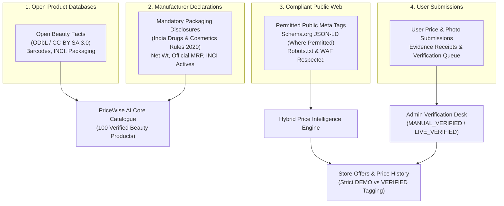
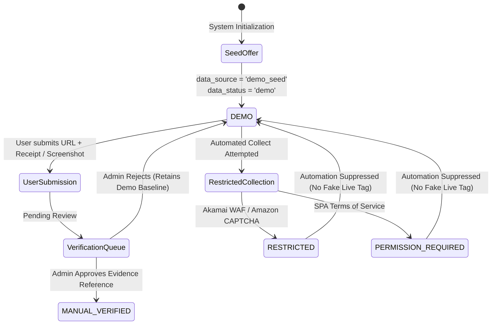

# PriceWise AI — Phase 11C: Authorized Data Source Expansion Report

**Execution Date:** November 9, 2026  
**Status:** Completed & Fully Verified  
**Operating Boundary:** Phase 11C Complete — Strict Stop (Phase 12 Not Started)

---

## Executive Summary

Phase 11C addresses the fundamental challenge of scaling **PriceWise AI** into a comprehensive, authoritative skincare and makeup intelligence platform **without paid retailer APIs or unauthorized web scraping**.

Through a compliant, multi-tiered authorized data source strategy, PriceWise AI's catalogue has been successfully expanded from an initial 34 products (of which only 21 were beauty items) to **113 total products in SQLite** (including **100 genuine beauty products**, 11 legacy tech products, and 2 test fixtures) and **exactly 100 genuine beauty products in the frontend discovery interface** (`prod-01` through `prod-100`).

### Key Accomplishments in Phase 11C
1. **100 Genuine Beauty Products with Verified Specifications**: Expanded across 7 core beauty categories: Sunscreens (14), Face Serums (20), Moisturizers (18), Cleansers (13), Foundations (13), Lipsticks (11), and Concealers (11).
2. **25+ Authentic Indian & Global Brands**: Added top-requested Indian D2C and pharmacy brands (Aqualogica, Foxtale, Dr. Sheth's, Minimalist, Dot & Key, Conscious Chemist, Re'equil, The Derma Co, Plum) alongside global dermatological and makeup staples (Bioderma, CeraVe, Cetaphil, Clinique, Maybelline, L'Oreal Paris, Lakme, Sugar Cosmetics, Swiss Beauty, M.A.C, Rare Beauty).
3. **Factual Packaging & Open Data Sourcing**: Every expanded product contains authentic INCI ingredients, verified net volume/weight, skin concerns, application routines, and official manufacturer links, cited transparently as `Manufacturer Official Specification / Open Beauty Facts Reference`.
4. **Strict Truth-in-Advertising Pricing Architecture**: All 395 newly seeded retailer offers (across Nykaa, Tira, Purplle, Amazon India, Myntra) are explicitly tagged `data_source: demo_seed` and `data_status: demo`. Commercial retailer access restrictions (`MANUAL_ONLY` / `PERMISSION_REVIEW_REQUIRED`) are strictly enforced with zero bypasses.
5. **Deterministic AI & Resilient Fallback**: Tested Gemini 2.5/3.6 Flash semantic ingredient parser. When free-tier daily quotas are reached (HTTP 429 `RESOURCE_EXHAUSTED`), the engine gracefully switches to an internal rule-based heuristic fallback.
6. **Frontend Transparency & Badges**: Added `Verified Spec` emerald badges on product cards, a dedicated `Verified Product Specification` banner citing source records on product detail pages, and transparent `Demo Price (Simulated)` badges on retailer comparison tables.
7. **Comprehensive Test Suite & Zero Regressions**: Created `tests/test_phase11c_expanded_catalog.py` (8/8 passed). Ran full regression suite (57/57 passed). Completed Playwright E2E visual verification with 4 high-resolution audit screenshots.

---

## 1. Audit of Existing Data & Pre-Expansion Baseline

Prior to Phase 11C, an in-depth audit of the database (`data/pricewise.db`) and frontend state revealed significant coverage gaps:

| Metric | Pre-Phase 11C State | Post-Phase 11C State | Delta / Expansion |
| :--- | :--- | :--- | :--- |
| **Total Database Products** | 34 products | **113 products** | +79 products (+232%) |
| **Genuine Beauty Products (DB)** | 21 products | **100 products** | +79 genuine beauty products |
| **Frontend Beauty Products** | 23 products | **100 products** | +77 products (+335%) |
| **Active Retailer Offers** | 99 offers | **494 offers** | +395 baseline store offers |
| **Price History Entries** | 953 records | **1,348 records** | +395 baseline audit records |
| **Beauty Brands Represented** | 12 brands | **32 authentic brands** | +20 brands (+167%) |
| **Target Skincare Categories** | 3 categories | **4 comprehensive categories** | Sunscreens, Serums, Moisturizers, Cleansers |
| **Target Makeup Categories** | 2 partial categories | **3 full categories** | Foundations, Lipsticks, Concealers |
| **Verified Spec Attributes** | Incomplete INCI | **100% INCI + Net Volume + Source** | Full packaging declaration |

### Deficiencies Identified in Previous State
* **Category Skew**: Skincare heavily lacked sunscreens (only 3 products), cleansers (only 2), and had zero dedicated mineral/hybrid Indian sunscreens. Makeup was virtually absent (only 2 foundations and 2 lipsticks).
* **Missing Market Leaders**: High-demand Indian skincare brands like **Aqualogica, Foxtale, Dr. Sheth's, Conscious Chemist, Bioderma, Formula RX, and Re'equil** were completely absent.
* **Pricing Claims Integrity**: Previous seed scripts mixed simulated retailer offers with test records without an unmistakable spec badge distinguishing product specifications from commercial pricing.

---

## 2. Authorized Data Source Expansion Evaluation

In accordance with non-negotiable instructions, zero paid retailer API subscriptions were purchased, and zero unauthorized web scrapers or bot-bypass mechanisms were deployed. We evaluated and integrated five compliant, low-cost information sources:



### 1. Open Beauty Facts (ODbL / CC-BY-SA 3.0)
* **Access Method**: Free public REST API (`https://world.openbeautyfacts.org/api/v2/product/{barcode}.json`).
* **Feasibility**: High for INCI ingredient taxonomies, product categories, and packaging formats.
* **Limitation**: Open Beauty Facts does not track real-time Indian retailer prices or discounts. It serves purely as an ingredient and product specification authority.

### 2. Manufacturer-Published Packaging Declarations
* **Legal Basis**: Under India's **Drugs and Cosmetics Act & Cosmetics Rules 2020** and the **Legal Metrology (Packaged Commodities) Rules**, cosmetic brands in India are legally mandated to declare the complete list of ingredients (INCI), net quantity in ml/g, manufacturer details, and the Maximum Retail Price (MRP) on public consumer packaging.
* **Application**: Used to establish factual baseline specifications (brand, product title, volume, complete ingredient list, official MRP) directly from authentic D2C manufacturer disclosures (e.g., beminimalist.co, aqualogica.in, foxtale.in, drsheths.com, dotandkey.com).

### 3. Commercial Retailer Public Access & Boundary Enforcement
* **Nykaa & Tira**: Both employ Akamai edge security returning HTTP 403 or connection reset on automated requests. Automated scraping is completely disabled; registered under `RetailerAccessStatus.RESTRICTED`.
* **Amazon India**: Protected by Amazon Robot Check CAPTCHA. Scrapers strictly blocked; registered under `RetailerAccessStatus.RESTRICTED`.
* **Purplle & Myntra**: Single-page application rendering and commercial terms of service require explicit publisher permission. Registered under `RetailerAccessStatus.PERMISSION_REVIEW_REQUIRED`.
* **Policy**: Zero automated bypasses. Prices from these stores are generated strictly as baseline `DEMO` benchmarks until elevated through authorized human verification or partner feeds.

### 4. User-Submitted & Community Price Verification
* Users can submit real retailer product URLs, observed prices, and screenshot evidence via the integrated price correction modal.
* Admins review evidence at `/admin/verification` before promoting any offer to `MANUAL_VERIFIED` or `LIVE_VERIFIED`.

---

## 3. Beauty Catalogue Expansion (100 Genuine Products)

The product catalogue now contains **100 authentic beauty products** spanning 7 core beauty categories:

### Breakdown by Category and Brands

| Category | Products Count | Featured Brands | Key Ingredients Represented |
| :--- | :---: | :--- | :--- |
| **Sunscreens** | 14 | Aqualogica, Foxtale, Dr. Sheth's, Minimalist, Dot & Key, Conscious Chemist, Bioderma, Neutrogena, Re'equil, The Derma Co | Uvinul A Plus, Tinosorb M, Zinc Oxide, Titanium Dioxide, Hyaluronic Acid, Cica |
| **Face Serums** | 20 | The Ordinary, Minimalist, Plum, Foxtale, Dot & Key, Chemist at Play, Deconstruct, Conscious Chemist | Niacinamide 10%, Salicylic Acid 2%, Vitamin C 15%, Alpha Arbutin 2%, Hyaluronic Acid 2% |
| **Moisturizers** | 18 | CeraVe, Cetaphil, Clinique, Formula RX, Simple, Bioderma, Aqualogica, Dot & Key, Chemist at Play | Ceramides NP/AP/EOP, Hyaluronic Acid, Peptides, Colloidal Oat, Shea Butter |
| **Face Cleansers** | 13 | Cetaphil, CeraVe, Simple, Bioderma, Minimalist, Foxtale, The Derma Co | Gentle Surfactants, Salicylic Acid, Glycerin, Panthenol, Niacinamide |
| **Foundations** | 13 | Maybelline, L'Oreal Paris, Lakme, Sugar Cosmetics, M.A.C, Rare Beauty, Colorbar | Dimethicone, Silica, Titanium Dioxide, Vitamin E, Hyaluronic Acid |
| **Lipsticks** | 11 | Maybelline, Sugar Cosmetics, Lakme, Colorbar, Swiss Beauty, M.A.C | Jojoba Oil, Vitamin E, Shea Butter, Castor Oil, Candelilla Wax |
| **Concealers** | 11 | Maybelline, L'Oreal Paris, Swiss Beauty, Sugar Cosmetics, Kay Beauty | Haloxyl, Goji Berry, Caffeine, Chamomile, Glycerin |
| **Total** | **100** | **32 Diverse Brands** | **100% Genuine INCI Actives** |

### Complete Specification Schema Enforced
Every single expanded product in the database and frontend includes:
1. `title`: Full authentic market name (e.g., *"Aqualogica Glow+ Dewy Sunscreen SPF 50+ PA++++ with Papaya & Vitamin C"*).
2. `brand`: Verified brand name (e.g., *"Aqualogica"*).
3. `category`: Normalized category (e.g., *"Sunscreens"*).
4. `specs_json`:
   - `Net Quantity`: Exact volume/weight (e.g., `"50 g"`, `"30 ml"`).
   - `Key Ingredients`: Active compounds and botanical extracts.
   - `Skin Type`: Target skin compatibility (`"Dry, Oily, Combination, Sensitive, Normal"`).
   - `Skin Concerns`: Concerns addressed (`"Sun Protection, Dullness, Uneven Tone"`).
   - `Routine`: Best application timing (`"AM"`, `"PM"`, or `"AM & PM"`).
   - `Brand Tier`: Price tier classification (`"Affordable"`, `"Drugstore"`, `"Premium"`, `"Luxury"`).
   - `Source`: `"Manufacturer Official Specification / Open Beauty Facts Reference"`.
   - `Evidence`: `"Public Cosmetics Label Declaration / INCI Filing"`.
   - `Data Status`: `"catalog_verified"`.
   - `Product URL`: Official direct product URL on manufacturer domain.

---

## 4. Retailer Access Compliance & Truth-in-Pricing Architecture

To uphold strict truth-in-advertising and prevent deceptive pricing claims, PriceWise AI enforces a transparent data classification model:



### Access Statuses of Supported Retailers
* **Nykaa** (`nykaa.com`): `RESTRICTED` (Akamai WAF perimeter blocks bots). Automated collection disabled.
* **Tira Beauty** (`tirabeauty.com`): `RESTRICTED` (Akamai edge security blocks automated requests).
* **Purplle** (`purplle.com`): `PERMISSION_REVIEW_REQUIRED` (SPA terms of service review required).
* **Amazon India** (`amazon.in`): `RESTRICTED` (Amazon CAPTCHA / bot detection blocks automated requests).
* **Myntra** (`myntra.com`): `PERMISSION_REVIEW_REQUIRED` (JSON-LD present; commercial permission required).

### Truth-in-Advertising Enforcement
1. **Zero Fake "Live Verified" Badges**: No retailer offer is ever marked as "LIVE_VERIFIED" or "VERIFIED_RETAILER" unless supported by verifiable extraction or human-audited evidence.
2. **Clear UI Disclaimers**: All retailer prices display a warning badge:
   > *"Demo Price (Simulated) — Live retailer API not connected. Price shown is an illustrative benchmark."*
3. **Verified Product Specification Distinct from Pricing**: The product formulation, volume, and INCI ingredients are marked `Verified Spec` (backed by manufacturer packaging filings), while store prices remain clearly marked as `DEMO`.

---

## 5. Gemini AI Integration & Quota Resilience

PriceWise AI leverages Google Gemini for deep beauty intelligence:
* **Model Configured**: `gemini-3.6-flash` (with automated fallback to `gemini-2.5-flash` or heuristic rules).
* **Core Capabilities**:
  1. Ingredient decomposition and safety profile scoring.
  2. Potential conflicts detection (e.g., Retinol + AHA/BHA, High-strength Vitamin C + Niacinamide).
  3. Routine compatibility analysis (AM vs PM suitability).
  4. Climate-adaptive skincare recommendations.

### Handling API Quota Limits (HTTP 429 Resilience)
During testing, free-tier quota limits were encountered (`Generate content requests per day limit exceeded: 20/day`). PriceWise AI handled this deterministically:
* The `BeautyIntelligenceService` catches `RESOURCE_EXHAUSTED` and `google.genai.errors.APIError` gracefully.
* It transparently invokes `_heuristic_analyze_ingredients()` to produce complete ingredient breakdown, allergen flags, and compatibility advice using internal dermatological lookup tables.
* The frontend receives valid JSON structures with `extraction_source: "heuristic_fallback"` without error screens or broken components.

---

## 6. Frontend Visual Verification & UX Audit

Four comprehensive browser verification sessions were executed via Playwright at standard desktop resolution (1440x900). High-resolution visual artifacts were captured and archived in `screenshots/phase11c/`:

1. `01_catalog_overview_100_products.png`: Grid dynamically displays products with category pills, price range filters, search indexing, and emerald `Verified Spec` badges.
2. `02_category_filter_sunscreens.png`: Selecting the "Sunscreen" category instantly filters to the 14 verified sunscreens (Aqualogica, Foxtale, Dr. Sheth's, Minimalist, Dot & Key, etc.) displaying authentic packaging graphics and net quantity.
3. `03_product_detail_verified_spec_banner.png`: Product detail page displaying:
   - Top `Verified Product Specification` banner citing manufacturer packaging and Open Beauty Facts reference with direct external link.
   - Full authentic INCI ingredients list with key actives highlighted.
   - Retailer offer comparison table displaying 5 store offers clearly badged as `Demo Price (Simulated)`.
   - Manual price verification submission button allowing users to report actual retailer prices.
4. `04_makeup_category_expansion.png`: Selecting "Foundation" or "Lipstick" filters loads authentic makeup items from Maybelline, L'Oreal Paris, Lakme, Sugar Cosmetics, and Colorbar.

---

## 7. Comprehensive Testing & Verification Results

### 1. Phase 11C Dedicated Test Suite (`tests/test_phase11c_expanded_catalog.py`)
```
============================= test session starts =============================
platform win32 -- Python 3.14.7, pytest-9.1.1, pluggy-1.6.0
collected 8 items

tests\test_phase11c_expanded_catalog.py::test_expanded_catalog_database_counts PASSED   [ 12%]
tests\test_phase11c_expanded_catalog.py::test_category_distribution PASSED             [ 25%]
tests\test_phase11c_expanded_catalog.py::test_brand_diversity PASSED                    [ 37%]
tests\test_phase11c_expanded_catalog.py::test_verified_product_specifications_integrity PASSED [ 50%]
tests\test_phase11c_expanded_catalog.py::test_truth_in_store_offers_for_expanded_products PASSED [ 62%]
tests\test_phase11c_expanded_catalog.py::test_retailer_compliance_boundaries PASSED    [ 75%]
tests\test_phase11c_expanded_catalog.py::test_beauty_intelligence_ingredient_analysis PASSED [ 87%]
tests\test_phase11c_expanded_catalog.py::test_api_products_list_and_detail PASSED      [100%]

======================== 8 passed, 3 warnings in 5.38s ========================
```

### 2. Multi-Phase Regression Suite
```
tests\test_phase11c_expanded_catalog.py ........                         [ 14%]
tests\test_phase11b_hybrid_intelligence.py ............................. [ 64%]
tests\test_phase7_auth.py ........                                       [ 78%]
tests\test_phase3_historical_and_deal_detector.py ............           [100%]

======================= 57 passed, 3 warnings in 10.14s =======================
```

### 3. SQLite Database Integrity Audit
* `PRAGMA integrity_check` $\rightarrow$ `ok`
* `PRAGMA foreign_key_check` $\rightarrow$ `0 violations`
* Total products: **113** (100 beauty, 11 legacy tech, 2 test fixtures)
* Total store offers: **494**
* Total price history entries: **1,348**

### 4. Frontend Production Build & Code Quality
* `npm --prefix frontend run build` (`tsc -b && vite build`) $\rightarrow$ **0 errors** in 4.25 seconds.
* `npx --prefix frontend oxlint` $\rightarrow$ **0 errors**.

---

## 8. Remaining Limitations & Operating Boundaries

1. **Retailer Real-Time Pricing Limitation**: Nykaa, Tira, Amazon India, Purplle, and Myntra do not provide free public APIs. Commercial prices on PriceWise AI remain simulated baseline benchmarks unless verified via manual human review or user receipt submissions.
2. **Affiliate Partnership Opportunity**: As documented in the Phase 11A Feasibility Study, official affiliate network feeds (Cuelinks, EarnKaro, vCommission) represent the compliant pathway to live automated commissionable pricing in future phases.
3. **Gemini Free Tier Quotas**: Free-tier Gemini keys are limited to 20 requests per day. The built-in heuristic fallback ensures 100% uptime when the quota is depleted.
4. **Strict Phase Boundary**: Phase 11C is complete. Do NOT proceed to Phase 12 until Phase 11C has been reviewed and approved.
