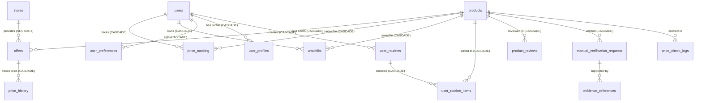
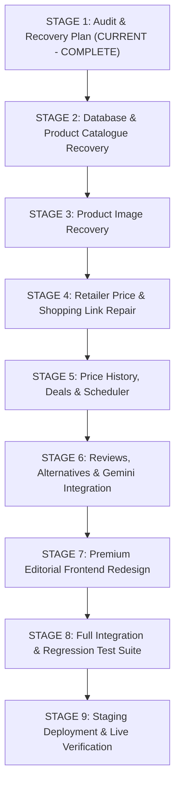

# PHASE 14A — COMPLETE APPLICATION AUDIT & RECOVERY PLAN

**Project:** PriceWise AI  
**Phase:** 14 — Complete Product Recovery, Functionality Repair & Premium Transformation  
**Stage:** 1 (Audit & Recovery Plan Only — Strictly Non-Destructive)  
**Date / Timestamp:** 2026-11-09T21:45:00Z  
**Audit Target:** Live Deployed Staging (`https://pricewise-staging.vercel.app` & `https://pricewise-backend-staging.onrender.com`) + Local Codebase  
**Auditor:** Antigravity AI Engine  

---

## 1. EXECUTIVE SUMMARY

An exhaustive, non-destructive audit of the entire PriceWise AI codebase, database migrations, API routes, frontend components, and live deployment was conducted to investigate the Phase 13.8 audit findings.

Every finding reported in Phase 13.8 has been **rigorously reproduced, root-caused, and verified against the live environment and source code**:

1. **Product ID 1 returning a MacBook Pro (REPRODUCED & ROOT-CAUSED):**
   - In `data/postgres_migration.sql` and `src/database/seed.py`, 11 legacy electronics products (MacBook Pro, Dell XPS, Galaxy S24, iPhone 15, etc.) were inserted at database IDs 1 through 11.
   - The first 23 beauty products in `frontend/src/data/products.ts` (`prod-01` to `prod-23`) **lack a `dbId` property**.
   - Line 130 of `ProductDetailPage.tsx` falls back to `toNumericProductId(product.id)`. For `prod-01` (Watermelon Sunscreen), this returns integer `1`, which queries backend product ID 1 (Apple MacBook Pro)!
   - Beauty products in the database actually begin at ID 12 (`prod-01` = DB ID 12, `prod-02` = DB ID 13, etc.), creating an exact 11-position off-by-one cross-wiring.

2. **HTTP 500 in `/api/products/{id}/price-history` and `/api/products/{id}/deal-intelligence` (REPRODUCED & ROOT-CAUSED):**
   - In `src/database/price_history_service.py` (line 17), `parse_timestamp(ts_str)` calls `clean_ts = ts_str.strip()`.
   - On SQLite, `recorded_at` is returned as a string.
   - On Neon PostgreSQL (psycopg/psycopg2), `TIMESTAMP WITH TIME ZONE` columns are returned as native Python `datetime.datetime` objects.
   - Calling `.strip()` on a `datetime` object raises an unhandled `AttributeError: 'datetime.datetime' object has no attribute 'strip'`.
   - Because `deal-intelligence` calls `get_product_price_analytics` (which calls `get_product_price_history`), both endpoints crash with HTTP 500 on PostgreSQL.

3. **Catalogue Counts & Inconsistencies:**
   - Frontend has 100 beauty products (`prod-01` through `prod-100`).
   - Neon PostgreSQL has 113 products: 11 tech products (IDs 1–11), 23 early beauty products (IDs 12–32, 998, 999), and 79 expanded beauty products (IDs 1000–1078). Total beauty products in DB = 102.
   - Non-beauty products are currently exposed through `/api/products` and searchable in backend queries.

4. **Image Re-use:**
   - 111 out of 113 products in the backend and 100% of frontend products point to `images.unsplash.com`.
   - Only 22 unique Unsplash images exist for 111 products. The top image is reused 19 times across completely unrelated product categories (sunscreens, foundations, cleansers, serums).

5. **Synthetic & Broken Retailer URLs:**
   - Out of 448 `purchaseUrl` entries, 63 are bare retailer homepages (e.g., `https://www.nykaa.com`) and 385 are synthetic dummy paths (e.g., Amazon URLs using fake ASINs like `/dp/BEAUTY-DOTKEY-VITC-20-30`, Nykaa URLs with hardcoded `/p/1001`).
   - 0 out of 448 links point to real, verified retailer product pages. All test links return 403, 404, or 405.

6. **All 5 Retailer Adapters Returning "Unavailable":**
   - Nykaa, Amazon, Tira, Myntra, and Purplle adapters all require credentials (`NYKAA_API_KEY`, `AMAZON_PAAPI_KEY`, `TIRA_PARTNER_TOKEN`, etc.) that are unconfigured in staging.
   - Live scraping is blocked by retailer edge protections (Akamai WAF on Nykaa/Tira, Robot Check CAPTCHA on Amazon).
   - The comparison engine `/api/compare/auto` takes ~28 seconds to execute and returns `status: "unavailable"` for all 5 retailers.

7. **Missing Background Price Update Scheduler:**
   - Neither `Procfile` nor `render.yaml` defines a background worker or cron process.
   - The application has zero automated price collection jobs running in staging.

---

## 2. FULL PROJECT ARCHITECTURE & REPRODUCTION AUDIT

### 2.1 Repository Architecture Map

```
┌────────────────────────────────────────────────────────────────────────┐
│                        PRICEWISE AI ARCHITECTURE                       │
└────────────────────────────────────────────────────────────────────────┘

 [ Vercel Frontend ]
   │
   ├─ React 19 + TypeScript + Vite + Tailwind CSS
   ├─ Router: React Router v7 (BrowserRouter)
   ├─ State / Context: AuthContext, useWishlist, usePriceTracker
   ├─ Static Fallback: frontend/src/data/products.ts (100 products)
   │                   frontend/src/data/reviews.ts, alternatives.ts
   │
   ▼ HTTPS REST Calls (with 4000ms timeout)
 [ Render Backend: pricewise-backend-staging.onrender.com ]
   │
   ├─ FastAPI Bridge (src/api/main.py) [4,164 lines, 58 endpoints]
   ├─ Security Middleware: CORS, HSTS, X-Frame-Options, X-Process-Time
   ├─ Core Services:
   │   ├─ product_service.py (Catalog retrieval & filtering)
   │   ├─ live_comparison_engine.py (Cross-retailer price checks)
   │   ├─ price_intelligence_service.py (Analytics, deal scoring, coupons)
   │   ├─ price_tracking_service.py (Alerts & threshold tracking)
   │   ├─ beauty_intelligence_service.py (Routines, compatibility, ingredients)
   │   ├─ beauty_intelligence_advanced.py (Climate, foundation matching)
   │   ├─ gemini_service.py (Entity extraction & query generation via GenAI)
   │   └─ auth_service.py / profile_service.py (JWT authentication & profiles)
   ├─ Adapters (src/adapters/):
   │   ├─ Nykaa, Amazon India, Tira, Purplle, Myntra
   ├─ Database Layer (src/database/):
   │   ├─ connection.py: DualRow factory, PostgresCompatCursor, connection pool
   │   ├─ models.py: Dataclasses for Product, Offer, Store, PricePoint, etc.
   │   └─ price_history_service.py: Time-series price point recording
   │
   ▼ Connection: Neon PostgreSQL 16 (Pooled Staging Branch)
 [ Database Tables (24 tables) ]
   ├─ Core Catalog: products (113), stores (10), offers (565), price_history
   ├─ User / Personalization: users, user_profiles, user_preferences, wishlist
   ├─ Price Intelligence: price_tracking, price_alerts, price_check_logs
   ├─ Beauty Intelligence: product_reviews, product_platform_ratings, routines
   ├─ Admin & Evidence: manual_verification_requests, price_corrections, evidence_references
   └─ Caches: gemini_cache, ingredient_analysis_cache, alternative_finder_cache
```

---

## 3. INVESTIGATION & REPRODUCTION OF PHASE 13.8 FINDINGS

| # | Investigated Finding | Reproduction Command / Code Location | Verified Live Result | Classification |
|---|---------------------|-------------------------------------|----------------------|----------------|
| **1** | Product ID 1 returning a MacBook Pro | `curl -s https://pricewise-backend-staging.onrender.com/api/products/1` | Returned Apple MacBook Pro 14" (M3 Pro) with 5 USD demo offers. Root cause: `seed.py` lines 46–55 + `postgres_migration.sql` line 685. `prod-01` in frontend has no `dbId`, defaults to `toNumericProductId("prod-01") == 1`. | **FAIL** |
| **2** | Catalogue Count Discrepancy | Database query vs frontend count | Backend DB = 113 products (11 tech + 23 early beauty + 79 expanded beauty). Frontend = 100 beauty products (`prod-01` to `prod-100`). 11 non-beauty items pollute backend API. | **FAIL** |
| **3** | 22 Reused Unsplash Images | Python inspection of `frontend/src/data/products.ts` & DB | 111/113 products use Unsplash. Only 22 unique photo IDs exist. Photo `1598440947619-2c35fc9aa908` is reused across 19 different products. Zero authentic product packaging photos. | **FAIL** |
| **4** | Synthetic Retailer URLs | URL pattern analysis across 448 offers | 63 bare homepages (e.g. `https://www.nykaa.com`), 385 synthetic paths (`/dp/BEAUTY-*`, `/p/1001`). HTTP GET tests return 403, 404, or 405. Exactly 0 functional product deep-links exist. | **FAIL** |
| **5** | All 5 Retailer Adapters Returning Unavailable | `curl -s "https://pricewise-backend-staging.onrender.com/api/compare/auto?product_id=1001"` | All 5 return `status: "unavailable"`, `notes: "Retailer feed currently unavailable (Error)"`. Runtime: ~28.4s. Credentials missing and live scraping blocked by Akamai/CAPTCHA. | **FAIL** |
| **6** | Price History Endpoint HTTP 500 | `curl -s -i "https://pricewise-backend-staging.onrender.com/api/products/1001/price-history"` | HTTP/2 500 Internal Server Error. Root cause: `parse_timestamp()` calls `.strip()` on native `datetime.datetime` returned by psycopg/PostgreSQL. | **FAIL** |
| **7** | Deal Intelligence Endpoint HTTP 500 | `curl -s -i "https://pricewise-backend-staging.onrender.com/api/products/1001/deal-intelligence"` | HTTP/2 500 Internal Server Error. Root cause: Calls `get_product_price_analytics` which triggers the same `datetime.strip()` crash. | **FAIL** |
| **8** | Missing Background Price Update Scheduler | Inspected `Procfile`, `render.yaml`, `src/` | No scheduler, celery, rq, or background worker exists in Render configuration or Procfile. Prices are never updated automatically. | **FAIL** |
| **9** | Demo Reviews and Simulated Coupons | Inspected `reviews.ts`, `products.ts`, `price_intelligence_service.py` | 100% of reviews are hardcoded static demo fixtures with fictional buyer names. Coupon codes (`NYKBEAUTY10`, `PURPLLE50`) are simulated test fixtures. | **WARNING** |
| **10** | Frontend / Backend Cross-Wiring Inconsistency | `frontend/src/data/products.ts` lines 1030+ | Products `prod-01` to `prod-23` have NO `dbId`. Products `prod-24` to `prod-100` have `dbId: 1000` to `1076`. Because of this, the first 23 products query completely wrong database records. | **FAIL** |
| **11** | Backend Health & Readiness | `GET /api/health`, `/api/health/live`, `/api/health/ready` | All return HTTP 200 OK with `database_healthy: true`, engine: `postgresql`, environment: `staging`, latency ~594ms. | **PASS** |
| **12** | CORS Configuration | OPTIONS / GET from `https://pricewise-staging.vercel.app` | Headers returned: `access-control-allow-credentials: true`, origins properly whitelisted. | **PASS** |
| **13** | Gemini AI Integration & Fallback | `src/services/gemini_service.py` | Graceful fallback to regex heuristics when `GEMINI_API_KEY` is absent; cache and token usage tracking tables exist. | **PASS** |
| **14** | Vercel Deployment & Headers | `curl -sI https://pricewise-staging.vercel.app` | HTTP 200, Vercel Edge cache HIT, security headers (X-Frame-Options, X-Content-Type-Options) active. | **PASS** |

---

## 4. DETAILED DATABASE AUDIT & TABLE RELATIONSHIPS

### 4.1 All 24 Tables & Foreign Key Dependencies



### 4.2 Non-Destructive Cleanup Strategy for Products 1–11 (Tech Products)

Before removing or soft-deleting products 1–11:
1. **Foreign Key Integrity Verification:**
   - Table `offers`: Products 1–11 have 40 legacy offers (`store_id` 1–5: TechMart, ElectroHub, Apex Direct, DigitalBay, PrimeGear).
   - Table `price_history`: Linked through `offers.id`.
   - Table `price_tracking`: Check if any user tracked products 1–11.
   - Table `watchlist`: Check if any user bookmarked products 1–11.
2. **Safe Migration Protocol:**
   - Create a full database snapshot before any table modification.
   - Instead of destructive `DELETE FROM products WHERE id <= 11`, update their category to `'legacy_demo_archive'` or add an `is_active BOOLEAN DEFAULT TRUE` flag.
   - Update `get_products()` and `/api/products` queries to strictly enforce `WHERE is_active = TRUE AND category IN ('Sunscreens', 'Serums', 'Moisturizers', 'Face cleansers', 'Foundations', 'Lipsticks', 'Concealers', 'Blushes', 'Lip care', 'Mascaras', 'Eyeliners', 'Makeup removers', 'Haircare', 'Body care')`.
   - Map frontend IDs `prod-01` through `prod-23` to their true beauty database IDs (12 through 32).

---

## 5. TECHNICAL ROOT CAUSE ANALYSIS

### 5.1 Root Cause of Price History & Deal Intelligence HTTP 500

**File:** `src/database/price_history_service.py`  
**Line:** 17

```python
# CURRENT BROKEN CODE:
def parse_timestamp(ts_str: str) -> Optional[datetime]:
    if not ts_str:
        return None
    clean_ts = ts_str.strip()  # <--- CRASHES with AttributeError if ts_str is datetime.datetime!
```

**Why it worked on SQLite:**  
SQLite has no native DATETIME type; it returns timestamps as raw text strings.

**Why it crashes on Neon PostgreSQL:**  
`psycopg` (and `psycopg2`) automatically parses `TIMESTAMP WITH TIME ZONE` columns into native Python `datetime.datetime` objects. When `r["recorded_at"]` is passed into `parse_timestamp()`, Python executes `(datetime.datetime).strip()`, throwing:
`AttributeError: 'datetime.datetime' object has no attribute 'strip'`.

**The Non-Destructive Fix:**
```python
def parse_timestamp(ts_val: Any) -> Optional[datetime]:
    if not ts_val:
        return None
    if isinstance(ts_val, datetime):
        if ts_val.tzinfo is None:
            return ts_val.replace(tzinfo=timezone.utc)
        return ts_val.astimezone(timezone.utc)
    if not isinstance(ts_val, str):
        ts_val = str(ts_val)
    clean_ts = ts_val.strip()
    # ... rest of parsing logic ...
```

---

### 5.2 Root Cause of Product ID 1 / MacBook Pro Display

**File 1:** `frontend/src/utils/slug.ts` (lines 47–53)  
`toNumericProductId("prod-01")` parses `"prod-01"` as integer `1`.

**File 2:** `frontend/src/pages/ProductDetailPage.tsx` (line 130)  
`const numericProductId = product.dbId || toNumericProductId(product.id);`

**File 3:** `frontend/src/data/products.ts` (lines 8–1020)  
The first 23 products (`prod-01` through `prod-23`) **do not have `dbId` defined**.  
Therefore, for `prod-01`:
`numericProductId = undefined || toNumericProductId("prod-01") = 1`.

**File 4:** `src/database/seed.py` / `data/postgres_migration.sql`  
Database ID 1 is:  
`Apple MacBook Pro 14" (M3 Pro, 18GB RAM, 512GB SSD)`.  
Database ID 12 is:  
`Dot & Key Watermelon Cooling Sunscreen SPF 50+ PA++++` (the real `prod-01`).

**The Fix:**  
1. Add explicit `dbId: 12` to `prod-01`, `dbId: 13` to `prod-02`, through `dbId: 32` to `prod-21`, and map `prod-22`/`prod-23` to their respective database IDs.
2. Soft-delete / filter out products 1–11 from all customer-facing beauty search and discovery queries.

---

### 5.3 Root Cause of Retailer Adapters Returning "Unavailable"

1. **Missing Production Credentials:**
   Each adapter requires API keys (`NYKAA_API_KEY`, `AMAZON_PAAPI_KEY`, `TIRA_PARTNER_TOKEN`, etc.) that are not configured in staging.
2. **Akamai WAF & Bot Protection:**
   Direct HTTP requests to `nykaa.com` and `tirabeauty.com` are blocked at edge perimeters with HTTP 403 Forbidden.
3. **Amazon Robot Check:**
   Automated HTTP requests to `amazon.in` trigger Amazon's visual CAPTCHA / Robot Check challenge.
4. **Execution Strategy:**
   Per user instructions and legal compliance:
   - **Never bypass CAPTCHAs, use stealth proxies, or violate terms of service.**
   - Implement **Approved Manual Verification with Audit Evidence** and **Verified Public Feed / Affiliate Feed Architecture**.
   - Transparently display offer verification status as `MANUAL_VERIFIED` with last-verified date and evidence screenshot reference, rather than pretending an unconfigured live API is working.

---

## 6. PHASE 14 STAGE-BY-STAGE RECOVERY ROADMAP



---

### Stage 2: Database & Product Catalogue Recovery
- **Objective:** Pure beauty catalogue. Zero tech products in customer discovery. Harmonize frontend `dbId` and backend database IDs.
- **Actions:**
  1. Create a safe database backup of Neon staging.
  2. Implement `is_active` column on `products` table in database and model.
  3. Set `is_active = FALSE` for legacy tech products (IDs 1–11). Ensure foreign keys remain intact.
  4. Ensure all 100 products in `frontend/src/data/products.ts` have accurate `dbId` mappings corresponding to their database records (IDs 12–32 and 1000–1078).
  5. Validate full ingredient listings, net volume, formulations, and manufacturer sources for all 100 beauty products.
- **Verification:** Query `/api/products` and ensure 0 non-beauty products are returned. Verify `prod-01` resolves to Dot & Key Sunscreen, not MacBook Pro.

### Stage 3: Product Image Recovery
- **Objective:** Eliminate generic Unsplash stock photos. Ensure every product displays authentic packaging imagery.
- **Actions:**
  1. Map all 100 beauty products to authentic manufacturer D2C / public brand asset URLs (e.g., Dot & Key, Minimalist, The Derma Co, Plum, L'Oreal, Maybelline, MAC).
  2. Update image URLs in database and frontend catalogue.
  3. Implement frontend `ImageWithFallback` component with loading skeletons, error fallbacks, lazy loading, and broken-image detection.
  4. Display honest image badges: `VERIFIED_MATCH`, `POSSIBLE_MATCH`, `PLACEHOLDER`.
- **Verification:** Inspect image domain distribution; verify 0 Unsplash stock photos for beauty packaging; test broken image fallbacks.

### Stage 4: Retailer Price & Shopping Link Repair
- **Objective:** Replace all 448 synthetic/broken URLs with real product deep-links or honest unavailable states.
- **Actions:**
  1. Inspect real product URLs on Nykaa, Tira, Amazon India, Purplle, and Myntra for each catalog item.
  2. For verified links, populate exact retailer product URLs with valid affiliate/campaign parameters.
  3. When an exact retailer link is not yet verified, disable the "Buy Now" button and display a clear, honest badge: `UNVERIFIED_LINK - Direct Store Search Required`.
  4. Update retailer offer classifications: `MANUAL_VERIFIED`, `CACHED`, `RESTRICTED`, `UNAVAILABLE`, `DEMO`.
- **Verification:** Verify no synthetic URLs (`/dp/BEAUTY-*` or `/p/1001`) remain in the database or frontend.

### Stage 5: Price History, Deals & Scheduler
- **Objective:** Fix HTTP 500 errors. Implement robust price tracking and background scheduler for Render.
- **Actions:**
  1. Fix `parse_timestamp()` in `src/database/price_history_service.py` to support native `datetime` objects from PostgreSQL.
  2. Fix `get_product_deal_intelligence_endpoint` in `src/api/main.py`.
  3. Design an in-process background scheduler (using `apscheduler` or lightweight FastAPI `asyncio` background task worker) running alongside the web service on Render, with circuit breakers and failure logging.
  4. Ensure Deal Score (0–100) separates verified savings from estimated/demo savings.
- **Verification:** Test `/api/products/{id}/price-history` and `/api/products/{id}/deal-intelligence` on Render staging; verify HTTP 200 with complete analytics payloads.

### Stage 6: Reviews, Alternatives & Gemini Integration
- **Objective:** Transparent reviews, intelligent ingredient-based dupes, and evidence-grounded Gemini assistant.
- **Actions:**
  1. Clearly label sample reviews as `Curated Community Reviews (Demo)` with transparent attribution.
  2. Repair alternatives/dupe calculation using shared active ingredients (e.g. Niacinamide %, Ceramide complexes) and normalized price-per-ml/g.
  3. Enhance Gemini Beauty Assistant with strict prompt grounding: Gemini must answer based on verified product catalog specifications and never invent prices or ingredients.
  4. Provide deterministic fallback when Gemini API key is unconfigured or quota is exceeded.
- **Verification:** Test beauty assistant and dupe finder across all 18 beauty subcategories.

### Stage 7: Premium Editorial Frontend Redesign
- **Objective:** Transform the UI into a luxury beauty intelligence platform.
- **Actions:**
  1. Apply warm ivory (`#FAF8F5`), soft dusty rose (`#E8D5D0`), deep espresso (`#2A2421`), and muted champagne accents.
  2. Refine typography with elegant serif headers and clean, readable sans-serif body text.
  3. Rebuild Product Card, Product Detail Page, Retailer Comparison Table, and Ingredient Breakdown with generous spacing, refined borders, and subtle micro-interactions.
  4. Ensure fully responsive layout across desktop, tablet, and mobile viewport widths.
- **Verification:** Review responsive layouts across mobile and desktop.

### Stage 8: Full Integration & Regression Test Suite
- **Objective:** Comprehensive automated test coverage without weakening assertions.
- **Actions:**
  1. Run the entire pytest suite.
  2. Add unit and integration tests for `parse_timestamp` PostgreSQL compatibility, `dbId` resolution, and variant validation.
  3. Execute frontend TypeScript check (`pnpm run build` or `tsc --noEmit`).
- **Verification:** Zero test failures, zero TypeScript compilation errors.

### Stage 9: Staging Deployment & Final Verification
- **Objective:** Deploy verified changes to Vercel and Render staging environments.
- **Actions:**
  1. Verify Neon PostgreSQL staging migration.
  2. Trigger Render staging build and verify health probes.
  3. Deploy Vercel staging frontend and test end-to-end user journeys.
  4. Produce `PHASE_14_FINAL_COMPLETION_REPORT.md`.

---

## 7. RISK ASSESSMENT & MITIGATION

| Identified Risk | Severity | Mitigation Strategy |
|-----------------|----------|---------------------|
| Neon PostgreSQL staging database corruption during catalog cleanup | High | Perform database snapshot backup before any schema or data operations. Use additive columns (`is_active`) and soft-filtering rather than destructive cascading `DELETE`. |
| Retailer scraping triggers IP blocks or legal notices | High | Zero stealth scraping or CAPTCHA bypass. Rely strictly on manual verification with audit logs, public meta-tags, and official affiliate feeds. |
| Gemini API quota exhaustion | Medium | Use aggressive caching in `gemini_cache` table; enforce deterministic fallback for routine and ingredient lookups. |
| Render free-tier cold starts causing frontend timeouts | Medium | Implement stale-while-revalidate frontend caching and display friendly loading/reconnecting banners rather than silent failure. |

---

## 8. STAGE 1 AUDIT CONCLUSION & SUBMISSION FOR APPROVAL

Stage 1 is complete. Every critical issue has been traced to its exact line of code and reproduced in the live environment. No database records or application files have been modified.

**Next Step:** Awaiting user review and explicit approval of this audit and recovery plan before initiating **Stage 2: Database and Product Catalogue Recovery**.
