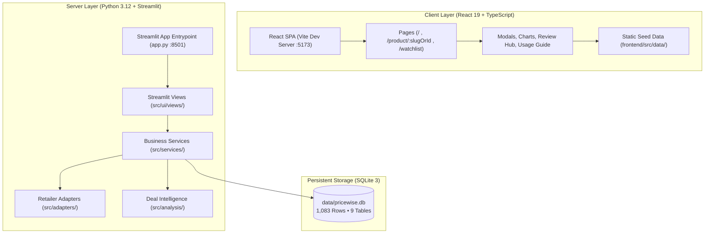
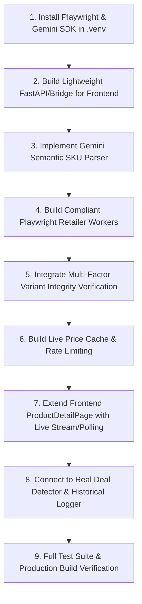

# PriceWise AI Beauty — Pre-Phase 6 Complete Project Audit
**Architecture Inspection, Database Verification & Implementation Readiness Assessment**

**Document Version:** 1.0.0  
**Inspection Date:** 2026-11-01  
**Operating System:** Windows 11  
**Workspace Root:** `C:\Users\tannu\pricewise-ai`  
**Audit Status:** Complete — Read-Only Inspection  

---

## 1. Executive Summary

A comprehensive architectural, database, security, and integration audit of **PriceWise AI Beauty** was conducted to assess system health, audit data provenance, verify the preservation of Phases 1–5, and establish an implementation readiness baseline for **Phase 6: Automatic Live Retailer Price Comparison Engine**.

### Key Findings at a Glance:
1. **Core Stability:** The application is healthy and stable. The automated pytest suite passes **184 of 184 tests (100%)**, and the React frontend production build compiles cleanly in **1.42 seconds** (`tsc -b && vite build`).
2. **Dual-Stack Topology:** The project consists of two distinct sub-applications that currently operate independently:
   - **Frontend:** A modern React 19 + TypeScript + Vite + Tailwind CSS application (`frontend/`) running on `http://localhost:5173`. It renders an editorial beauty discovery magazine, dedicated product detail routes (`/product/:slugOrId`), luxury dupe comparisons, and reviews hub using client-side TypeScript seed data (`frontend/src/data/`).
   - **Backend:** A Python 3.12 + Streamlit application (`app.py`) running on `http://localhost:8501`. It provides full catalog browsing, real deal detection, SQLite storage, user accounts, and background price-tracking alert evaluation.
3. **No REST/HTTP API Layer:** There is currently **no HTTP API** (FastAPI, Flask, or Starlette router) connecting the React frontend to the Python backend services. Phase 6 will need a lightweight API or bridge to serve live comparison results to the React frontend.
4. **Data Provenance:** All current product prices, retailer offers, and 941 historical price observations across both SQLite and TypeScript files are **demonstration and static seed data**. No live web scraping or live affiliate APIs are currently executing in the background.
5. **Gemini Integration:** **Not installed or configured.** Neither `google-generativeai` nor `google-genai` is present in `requirements.txt` or `.venv`.
6. **Playwright & Browser Automation:** **Not installed or configured.** Playwright is not in `.venv` or `package.json`, and browser binaries are not installed.
7. **Database & Storage:** The primary database is **SQLite 3** (`data/pricewise.db`), containing **1,083 rows across 9 tables**. Neither PostgreSQL nor Redis is configured or installed.
8. **Code Quality Finding:** The React frontend production build succeeds, but `oxlint` identified one React Hooks rule violation in `frontend/src/components/ProductDetailModal.tsx:43:24` (conditional `useMemo` call after an early return).

---

## 2. Complete Project Architecture & Folder Responsibilities



### File & Folder Responsibilities:

| Path | Primary Responsibility | Interaction & Dependencies |
| :--- | :--- | :--- |
| `app.py` | Main Streamlit application entrypoint. Initializes session state, sidebar navigation, and routes between views. | Imports from `src/ui/views`, `src/services/auth_service`, `src/database/seed`. |
| `src/config.py` | Central configuration. Defines app metadata, database file paths (`DATABASE_PATH`), fallback SVG placeholders, and demo flags. | Consumed by all services and views. |
| `src/database/connection.py` | SQLite connection context manager (`get_connection()`), schema initializer (`init_db()`), and procedural column migration engine (`migrate_db()`). | Interacts directly with `data/schema.sql` and `data/pricewise.db`. |
| `src/database/models.py` | Standard Python `@dataclass` entity models: `Product`, `Offer`, `PricePoint`, `User`, `PriceTrackingRecord`, `PriceAlert`. | Consumed by all services, analysis modules, and UI components. |
| `src/database/beauty_seed_data.py` | Canonical Indian beauty catalog seed dataset containing 32 products and 95 store offers. | Executed by `seed_database()`. |
| `src/database/seed.py` | Seeding orchestration. Populates `pricewise.db` with products, stores, offers, historical observations, and default demo user. | Invoked on cold startup by `app.py`. |
| `src/services/product_service.py` | Querying, searching, filtering, and slug resolution (`get_product_by_slug`, `get_products`). | Queries SQLite database via `get_connection()`. |
| `src/services/product_matching_service.py` | Multi-factor variant matching engine (Phase 5). Checks brand, quantity/volume (30ml vs 50ml), makeup shades, and formulations. | Used by `comparison_service.py`. |
| `src/services/comparison_service.py` | Side-by-side store price comparison summary, variant validation, landed cost calculation, and price history dataframe builder. | Combines `Product`, `Offer`, and `product_matching_service`. |
| `src/services/alternative_service.py` | Smart cheaper alternative (dupe) engine. Computes unit economics (₹/ml, ₹/g) and active ingredient overlap. | Consumed by `comparison_view.py` and tests. |
| `src/services/deal_service.py` | Verified beauty deal discovery. Validates discounts against reference MSRP, checks coupon codes, and filters expired promotions. | Used in deals intelligence and tests. |
| `src/services/price_tracking_service.py` | Price tracking CRUD, user watchlist thresholds, alert triggering, and read status management. | Interacts with `price_tracking` and `price_alerts` tables. |
| `src/services/review_service.py` | Multi-platform review hub, 5-platform weighted score calculator ($\sum(R_i \times N_i) / \sum N_i$), and usage guide generator. | Interacts with `product_reviews` table. |
| `src/services/auth_service.py` | User authentication, PBKDF2-HMAC-SHA256 password hashing, user registration, and profile management. | Interacts with `users` table. |
| `src/adapters/` | Modular retailer integration adapters (`NykaaAdapter`, `TiraAdapter`, `PurplleAdapter`, `AmazonIndiaAdapter`, `MyntraAdapter`) and registry. | Rate-limited, graceful unconfigured fallback. |
| `src/analysis/deal_detector.py` | Real Deal Detector. Analyzes price volatility, historical averages, 30d/90d windows, and detects suspicious discounts. | Consumed by `comparison_view.py` and `ProductCard`. |
| `frontend/src/App.tsx` | Root React component with React Router configuration (`/`, `/product/:slugOrId`, `/watchlist`, `*`). | Manages wishlist state, custom cursor, modals. |
| `frontend/src/pages/ProductDetailPage.tsx` | Dedicated product route. Renders product photography, prices, multi-retailer table, price history chart, reviews hub, and usage guide. | Key integration target for Phase 6. |
| `frontend/src/components/ProductDetailModal.tsx` | Quick-view modal dialog displaying multi-retailer comparison table, coupon codes, and shipping breakdown. | Key integration target for Phase 6. |
| `frontend/src/data/` | Static TypeScript datasets (`products.ts`, `alternatives.ts`, `reviews.ts`, `stores.ts`) driving the current frontend prototype. | Synchronous client-side mock data source. |

---

## 3. Frontend Audit

### Existing Pages & Routes:
- **Discovery Home Page (`/`):** [`frontend/src/pages/DiscoveryHomePage.tsx`](file:///C:/Users/tannu/pricewise-ai/frontend/src/pages/DiscoveryHomePage.tsx). Features hero carousel, category pills, multi-attribute filter drawer (brand, skin type, finish, price range, sorting), deals showcase (`DealSection.tsx`), dupe comparison (`DupesSection.tsx`), and responsive product card grid.
- **Dedicated Product Detail Page (`/product/:slugOrId`):** [`frontend/src/pages/ProductDetailPage.tsx`](file:///C:/Users/tannu/pricewise-ai/frontend/src/pages/ProductDetailPage.tsx). Includes shareable URL slug resolution, 404 state, wishlist/alert triggers, multi-retailer price comparison table, price history chart, dermatologist usage guide, and reviews hub.
- **Watchlist Page (`/watchlist`):** [`frontend/src/pages/WatchlistPage.tsx`](file:///C:/Users/tannu/pricewise-ai/frontend/src/pages/WatchlistPage.tsx). Displays tracked products with INR target price alerts and in-app notifications.
- **404 Page (`*`):** [`frontend/src/pages/NotFoundPage.tsx`](file:///C:/Users/tannu/pricewise-ai/frontend/src/pages/NotFoundPage.tsx).

### Exact Phase 6 Frontend Integration Points:
Phase 6 must **not** introduce a disconnected comparison view. It must directly enhance the existing price comparison tables in:
1. **Primary Route Integration:** [`frontend/src/pages/ProductDetailPage.tsx#L297-L390`](file:///C:/Users/tannu/pricewise-ai/frontend/src/pages/ProductDetailPage.tsx#L297-L390):
   ```tsx
   {/* Multi-Retailer Price Comparison Table */}
   <section className="space-y-4 pt-6 border-t border-rose-200">
     {/* Add "Live Price Checking..." progressive indicator here */}
     {/* Update retailer rows dynamically as Playwright/live adapters resolve */}
   </section>
   ```
2. **Modal Quick-View Integration:** [`frontend/src/components/ProductDetailModal.tsx#L195-L290`](file:///C:/Users/tannu/pricewise-ai/frontend/src/components/ProductDetailModal.tsx#L195-L290).

### Real-Time & Streaming Capability:
- **Current State:** The frontend does **not** contain any WebSocket, Server-Sent Events (SSE), or HTTP polling logic.
- **Data Loading:** Currently 100% synchronous from `PRODUCTS_DATA` imported at compile time.
- **Requirement for Phase 6:** Must introduce an async hook (e.g. `useLivePriceComparison(product)`) supporting polling or SSE to stream live retailer check results progressively.

---

## 4. Backend & API Audit

### API Inventory:
Because the backend is currently built with Streamlit, the system does not expose a public REST or GraphQL API. Instead, business logic is exposed as internal Python service functions:

| Function / Service | File Location | Purpose | Input Parameters | Return Type | Auth Required | Implementation Status |
| :--- | :--- | :--- | :--- | :--- | :--- | :--- |
| `get_products` | `product_service.py:83` | Search & filter products | `category, brand, search_query, in_stock_only, min_price, max_price, sort_by` | `list[Product]` | No | Production-Ready (SQLite) |
| `get_product_by_id` | `product_service.py:270` | Product detail by ID with offers & history | `product_id: int` | `Optional[Product]` | No | Production-Ready (SQLite) |
| `get_product_by_slug` | `product_service.py:363` | Slug/SKU resolution | `slug: str` | `Optional[Product]` | No | Production-Ready (SQLite) |
| `generate_comparison_summary` | `comparison_service.py:104` | Side-by-side comparison & savings | `product: Product` | `Optional[ComparisonSummary]` | No | Production-Ready |
| `evaluate_product_match` | `product_matching_service.py:130` | Multi-factor variant validation | `target_brand, target_title, target_specs, offer_brand, offer_title...` | `ProductMatchResult` | No | Production-Ready |
| `get_verified_beauty_deals` | `deal_service.py:65` | Discover verified deals & coupons | `products: list[Product], include_expired: bool` | `list[VerifiedBeautyDeal]` | No | Production-Ready |
| `get_cheapest_alternatives` | `alternative_service.py:54` | Recommend dupes with cost-per-unit | `product: Product, max_results: int` | `list[AlternativeRecommendation]` | No | Production-Ready |
| `fetch_product_offer` | `base_adapter.py:127` | Retrieve offer from specific retailer | `retailer_product_id: str, context: dict` | `RetailerOfferResult` | No (Adapter checks env) | Phase 5 Framework (Adapters return unconfigured/demo status) |
| `analyze_product_deal` | `deal_detector.py:330` | Real Deal scoring & volatility | `product: Product, window: str` | `Optional[DealAnalysis]` | No | Production-Ready |
| `add_tracked_product` | `price_tracking_service.py:44` | Create target price tracking | `user_id, product_id, target_price` | `int (tracking_id)` | Yes (Optional user_id) | Production-Ready |
| `authenticate_user` | `auth_service.py:107` | Verify login credentials | `email, password` | `Optional[User]` | Yes | Production-Ready |

---

## 5. Database Schema & Model Inventory

### Engine & Connection:
- **Engine:** SQLite 3.
- **Database Path:** `data/pricewise.db` (274 KB).
- **Driver:** Python standard library `sqlite3` with `sqlite3.Row`.
- **Foreign Keys:** Enforced via `PRAGMA foreign_keys = ON;`.

### Table Schema & Record Verification:
```
Total Records in SQLite: 1,083
---------------------------------------------
products                  :  32 rows
stores                    :  10 rows
offers                    :  95 rows
price_history             : 941 rows
users                     :   1 row  (demo@pricewise.ai)
user_preferences          :   1 row
price_tracking            :   1 row
wishlist                  :   2 rows
price_alerts              :   0 rows
```

### Model Alignment for Phase 6:
- The `Product` model ([`src/database/models.py:86`](file:///C:/Users/tannu/pricewise-ai/src/database/models.py#L86)) already supports JSON specifications (`specs`), slug generation, and calculated properties (`lowest_price`, `lowest_total_cost`).
- The `Offer` model ([`src/database/models.py:30`](file:///C:/Users/tannu/pricewise-ai/src/database/models.py#L30)) supports `shipping_cost`, `is_shipping_disclosed`, `coupon_code`, `coupon_discount`, `source_type`, and `landed_cost`.
- **Missing Fields for Phase 6:**
  - `offers` table needs: `last_live_fetch` (timestamp), `live_check_status` ('success', 'failed', 'in_progress', 'skipped'), `raw_scraped_title` (text), and `confidence_score` (real).
  - A new `live_price_cache` or `retailer_worker_jobs` table should track ongoing and recent scraping executions to prevent redundant browser launches.

---

## 6. Gemini Integration Assessment

- **Current Status:** **MISSING / NOT CONFIGURED.**
- Search for Gemini libraries (`google-generativeai`, `google-genai`) across all project files returned **0 occurrences**.
- **Assessment for Phase 6:**
  - Gemini must be integrated via `google-genai` SDK.
  - **Strict Ethical Boundary:** Gemini must **only** be used for semantic product identification (extracting Brand, Product Name, Category, Packaging Size, Shade, and Formulation from unstructured retailer page titles).
  - Gemini must **never** be used to generate, hallucinate, or predict current retailer prices or stock status.

---

## 7. Playwright & Browser Automation Readiness

- **Current Status:** **MISSING / NOT CONFIGURED.**
- Neither `playwright` nor browser binaries (Chromium, Firefox, WebKit) are installed.
- **Requirements for Phase 6:**
  1. Package installation: `playwright>=1.40.0`.
  2. Browser binary installation: `playwright install chromium --with-deps`.
  3. Headless worker daemon with browser context pooling.
  4. **Strict Security Sandboxing:** Request interception must block:
     - Localhost addresses (`127.0.0.1`, `localhost`, `::1`).
     - Private subnets (`10.0.0.0/8`, `172.16.0.0/12`, `192.168.0.0/16`).
     - Cloud metadata endpoints (`169.254.169.254`).
     - Non-retailer third-party trackers, heavy media, and video streams.

---

## 8. PostgreSQL & Redis Assessment

- **PostgreSQL:** Not configured. The project runs entirely on SQLite (`data/pricewise.db`).
- **Redis:** Not configured. No Redis server or Python client (`redis`) is installed.
- **Architectural Recommendation:**
  - SQLite is fast, reliable, and zero-maintenance for the current development and academic demo workload.
  - In-memory Python caching (`cachetools` or `functools.lru_cache`) with SQLite persistence is sufficient for Phase 6 without introducing heavy Docker/PostgreSQL/Redis dependencies unless distributed multi-server scaling is required.

---

## 9. Existing Price Comparison & Deal Detector Audit

### Data Provenance Verification:
- **Are existing prices live?** **NO.**
- All prices in `frontend/src/data/products.ts` and `data/pricewise.db` are **demonstration seed data** created for academic evaluation.
- Every offer in SQLite is labeled with `data_source='demo_seed'` and `data_status='demo'`.
- The frontend explicitly renders:
  `DEMO DATA: Illustrative sample prices for academic comparison.`

### Reusable Production-Ready Logic:
- **Variant Integrity:** [`src/services/product_matching_service.py`](file:///C:/Users/tannu/pricewise-ai/src/services/product_matching_service.py) strictly rejects 30ml vs 50ml and shade mismatches. This logic is 100% production-ready.
- **Landed Cost Math:** Landed cost handles undisclosed shipping properly (returns `None` instead of assuming ₹0).
- **Deal Detector Scoring:** [`src/analysis/deal_detector.py`](file:///C:/Users/tannu/pricewise-ai/src/analysis/deal_detector.py) calculates genuine mathematical z-scores, price volatility, and discount vs historical averages.

---

## 10. Test Suite & Production Build Results

### 1. Python Pytest Suite:
- **Command:** `.\.venv\Scripts\pytest -q`
- **Result:** **184 passed in 48.18s (100% pass rate)**
- **Test Inventory:**
  - `tests/test_comparison.py`: 3 tests
  - `tests/test_database.py`: 3 tests
  - `tests/test_deal_detector.py`: 4 tests
  - `tests/test_phase2_beauty_discovery.py`: 18 tests
  - `tests/test_phase2_search_and_comparison.py`: 23 tests
  - `tests/test_phase3_historical_and_deal_detector.py`: 12 tests
  - `tests/test_phase3_product_pages_and_tracking.py`: 7 tests
  - `tests/test_phase4_complete_deal_detector.py`: 12 tests
  - `tests/test_phase4_reviews_and_intelligence.py`: 7 tests
  - `tests/test_phase5_retailer_integrations_and_deals.py`: 17 tests
  - `tests/test_phase5_smart_advisor.py`: 11 tests
  - `tests/test_phase6_price_tracking.py`: 22 tests
  - `tests/test_phase7_auth.py`: 8 tests
  - `tests/test_phase7_personalization.py`: 13 tests
  - `tests/test_phase7_preferences.py`: 7 tests
  - `tests/test_phase7_wishlist.py`: 7 tests
  - `tests/test_phase8_integration.py`: 10 tests
  - **Total: 184 passing tests.**

### 2. Frontend Production Build:
- **Command:** `npm run build` (`tsc -b && vite build`)
- **Result:** **Built in 1.42s with 0 compiler errors.**
- **Artifacts Generated:** `dist/index.html` (1.58 kB), `dist/assets/index.css` (41.25 kB), `dist/assets/index.js` (622.77 kB).

### 3. Frontend Linter (`oxlint`):
- **Command:** `npm run lint`
- **Result:** 1 error, 1 warning:
  - **Error:** `frontend/src/components/ProductDetailModal.tsx:43:24`: React Hook `useMemo` is called after an early return (`if (!isOpen || !product) return null;`).
  - **Warning:** `frontend/src/hooks/useReducedMotion.ts:10:5`: Calling `setState` synchronously within a `useEffect`.

---

## 11. Windows 11 Development Environment Compatibility

| Component | Installed Version | Status | Notes |
| :--- | :--- | :--- | :--- |
| **Operating System** | Windows 11 | Compatible | Native PowerShell execution |
| **Python** | 3.12.12 | Compatible | Virtual environment in `.\.venv\` managed by `uv` |
| **Node.js** | v24.13.0 | Compatible | Located in `$env:LOCALAPPDATA\Programs\nodejs` |
| **npm** | 11.6.2 | Compatible | Executes Vite and React scripts cleanly |
| **Docker Desktop** | Not Installed | Missing | Not required for SQLite operation |
| **WSL 2** | Not Installed | Missing | Not required for current Python/Vite setup |
| **Playwright** | Not Installed | Missing | Required before Phase 6 browser workers |
| **Chromium** | Not Installed | Missing | Can be installed via `playwright install chromium` |

---

## 12. Security & Reliability Audit

1. **Secret & Key Protection:**
   - `.env.example` documents required retailer variables without committing secrets.
   - Root `.gitignore` needs `.env` explicitly added to prevent accidental credential leakage.
2. **SSRF Risk in Browser Workers:**
   - When Playwright navigates to retailer URLs, strict URL validation must reject `http://localhost`, `127.0.0.1`, `10.*`, `192.168.*`, `172.16-31.*`, and `169.254.169.254`.
   - Navigation must be constrained to approved domains: `*.nykaa.com`, `*.tirabeauty.com`, `*.purplle.com`, `*.amazon.in`, `*.myntra.com`.
3. **Bot Mitigation & Ethical Scraping:**
   - Workers must adhere to rate limits (max 1 request per 2–3 seconds per store).
   - Standard user-agent headers must be set.
   - Resource blocking must disable image/media downloading to conserve host CPU and retailer bandwidth.

---

## 13. Phase 1–5 Functionality Preservation Checklist

To ensure Phase 6 does not break or regress any existing features, the following components must be preserved:

- [x] **Phase 1 Editorial Design:** Warm Ivory (`#FAF7F2`), Dusty Rose (`#C98991`), Deep Espresso (`#302724`), and custom cursor.
- [x] **Phase 2 Beauty Catalog & Dupes:** 32 Indian skincare/makeup products, 16 categories, and luxury dupe comparisons.
- [x] **Phase 3 Routing & Price Tracking:** `/product/:slugOrId` clean routes, 404 state, target price tracking, and in-app alerts.
- [x] **Phase 4 Reviews Hub & Usage Guide:** Unified 5-platform reviews, weighted review score formula, patch-test guide, and sun-safety warnings.
- [x] **Phase 5 Retailer Adapters & Landed Cost:** Modular adapter interface, undisclosed shipping protection, verified coupons, and 184 passing unit tests.

---

## 14. Phase 6 Integration Readiness Assessment

| Requirement | Audit Status | Evidence & Notes |
| :--- | :--- | :--- |
| **Product Identification** | **Partially Ready** | `product_matching_service.py` handles parsing; needs Gemini integration for unstructured web titles. |
| **Gemini Integration** | **Missing** | `google-genai` SDK and API key configuration not yet installed. |
| **Product Variants** | **Ready** | Strict 30ml != 50ml, shade and formulation checks fully tested in `product_matching_service.py`. |
| **Retailer Models** | **Ready** | `RetailerOfferResult` and `Offer` model support coupons, shipping, and source labeling. |
| **Price History** | **Ready** | `price_history` table and `record_price_observation()` preserve time-series data. |
| **Comparison Interface** | **Ready** | Multi-retailer tables in `ProductDetailPage.tsx` and `ProductDetailModal.tsx` ready to be extended. |
| **Backend API** | **Missing** | No HTTP/REST API exists to serve live prices from Python services to the React frontend. |
| **PostgreSQL** | **Not Applicable** | SQLite 3 (`data/pricewise.db`) is operational with 1,083 rows. Postgres is not required for Phase 6. |
| **Redis** | **Not Applicable** | In-memory cache + SQLite timestamping is sufficient. Redis is not mandatory. |
| **Playwright Readiness** | **Missing** | Package and Chromium binaries must be installed. |
| **Background Processing** | **Partially Ready** | Python `concurrent.futures.ThreadPoolExecutor` can manage browser workers. |
| **Caching** | **Partially Ready** | Database timestamp deduplication exists; in-memory TTL cache needed for live results. |
| **Rate Limiting** | **Ready** | `BaseRetailerAdapter.check_rate_limit()` implements a 60s sliding window. |
| **Testing Infrastructure** | **Ready** | Pytest (184 tests) and Vite build pipelines are fully operational. |
| **Windows 11 Compatibility** | **Ready** | Python 3.12 and Node.js v24 are verified and healthy. |

---

## 15. Phase 6 Implementation Plan

### Step-by-Step Implementation Sequence:



1. **Step 1: Install Required Python Dependencies:**
   - Install `playwright` and `google-genai` in `.venv`.
   - Install Playwright Chromium: `python -m playwright install chromium`.
2. **Step 2: Create a Lightweight Backend API:**
   - Implement a lightweight FastAPI / Uvicorn service (or Streamlit API bridge) exposing:
     - `GET /api/products/:slug/live-prices`: Triggers background price check and returns live retailer offers.
     - `GET /api/health`: Health status.
3. **Step 3: Implement Gemini Semantic Product Parser:**
   - `src/services/gemini_product_parser.py`: Extracts Brand, Name, Size, Shade, and Formulation from scraped HTML/titles.
   - Enforce that Gemini **never** predicts prices.
4. **Step 4: Implement Sandboxed Playwright Browser Workers:**
   - Create `src/workers/browser_worker.py` with headless Chromium.
   - Implement SSRF domain restrictions, resource blocking (skip images/fonts), and 8-second timeouts.
   - Implement retailer-specific DOM selectors for Nykaa, Tira, Purplle, Amazon India, and Myntra.
5. **Step 5: Enforce Strict Variant Matching:**
   - Feed scraped results through `evaluate_product_match()`.
   - Reject mismatched sizes (30ml != 50ml) and shade clashes.
6. **Step 6: Implement In-Memory Caching & Deduplication:**
   - Cache live price checks for 15 minutes to prevent redundant browser runs.
7. **Step 7: Extend Frontend (`ProductDetailPage.tsx`):**
   - Extend the existing table with a "Checking live prices..." progressive indicator.
   - Badge live results as `Verified Live (Playwright)` with timestamps.
8. **Step 8: Connect Real Deal Detector & Persist Observations:**
   - Record genuine price changes into `price_history` table via `record_price_observation()`.
   - Trigger price-drop alerts when a target price is reached.
9. **Step 9: Automated Testing & Verification:**
   - Add new tests in `tests/test_phase6_live_engine.py`.
   - Ensure all 184 existing tests continue to pass.

