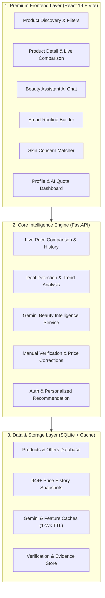
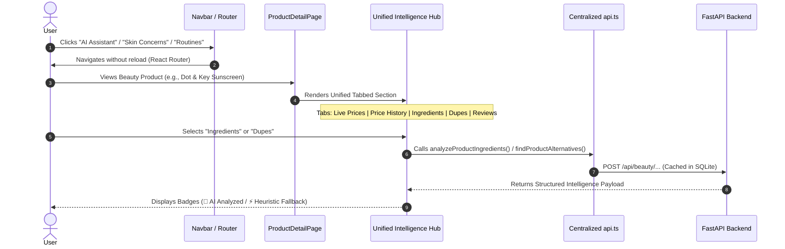
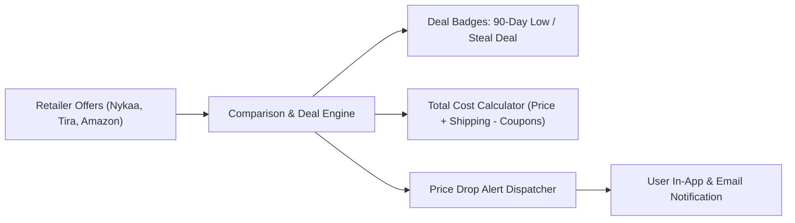

# PriceWise AI — Master Development Roadmap & Project Stabilization

**Document Version:** 1.0.0  
**Date:** November 9, 2026  
**Status:** Approved Architecture Plan  
**Repository:** `c:\Users\humai\price-comparison-website`  

---

## 1. Executive Vision & Core Pillars

PriceWise AI is an editorial beauty shopping intelligence and price discovery platform tailored specifically for the Indian cosmetics and skincare market. By uniting rigorous price analytics with Gemini-powered ingredient and dermatological intelligence, PriceWise AI empowers consumers to find the highest-efficacy skincare at the lowest transparent price across top Indian retailers (Nykaa, Tira, Purplle, Myntra, Amazon India).

### The Six Strategic Pillars
1. **Advanced Price Comparison (Xerve-Inspired)**: Multi-retailer price tracking with transparent shipping, coupon disclosure, and price history analytics.
2. **Gemini-Powered Beauty Intelligence**: Deep ingredient analysis, routine step ordering, conflict detection, and conversational assistance.
3. **Product Discovery & Matching**: Formulations, skin-type tagging, and variant matching (e.g. 50ml gel vs. 100ml lotion).
4. **Historical Price Analytics & Deal Detection**: 30/90/180-day price trends, all-time-low badges, and target price drop alerts.
5. **Cheaper Alternatives & Dupe Finder**: Active-ingredient equivalence matching with mathematical similarity and price-saving percentages.
6. **Graceful Heuristic Fallback & Cost Protection**: Offline smart heuristics, per-user token quotas, and SQLite caching to ensure 100% platform availability without runaway API expenses.

---

## 2. Current Repository Audit & Baseline Verification

### 2.1 Technology Stack Baseline
* **Frontend**: React 19.3.1, TypeScript 7.0.2, Vite 8.3.5, Tailwind CSS 3.4.19, Lucide React 1.66.0, Framer Motion 14.9.0, Oxlint 1.89.0.
* **Backend**: FastAPI 0.141.1, Python 3.14 (and 3.12 compatibility), Uvicorn 0.52.4, Playwright 1.64.1 (for local verification), Pydantic 2.13.5.
* **Database**: SQLite 3 (`data/pricewise.db`, 568 KB) with WAL mode, foreign key enforcement, and indexed queries.
* **AI Provider**: Google GenAI SDK (`google-genai` 2.25.0) targeting `gemini-3.6-flash`, backed by deterministic heuristic rules when offline.

### 2.2 Database Integrity Audit
All 25 existing tables and records have been verified intact:

| Table Name | Record Count | Purpose / Health Status |
| :--- | :--- | :--- |
| `products` | 34 | Curated Indian beauty catalog (Dot & Key, Minimalist, Plum, etc.) |
| `offers` | 97 | Multi-retailer price offers across Nykaa, Amazon, Tira, Purplle |
| `price_history` | 944 | Historical pricing records for trend chart generation |
| `stores` | 10 | Retailer metadata (Nykaa, Amazon, Tira, Purplle, Myntra, etc.) |
| `users` | 80 | User accounts with hashed credentials |
| `user_profiles` | 47 | Skin types, concerns, budget tiers, and avoidances |
| `user_preferences` | 80 | Granular category and brand preference mappings |
| `user_routines` | 32 | Saved AM and PM custom skincare routines |
| `user_routine_items` | 121 | Products mapped to steps within saved routines |
| `ingredient_analysis_cache`| 10 | Cached Gemini ingredient breakdown payloads |
| `gemini_token_usage` | 11 | Audit log of prompt and completion token counts |
| `gemini_rate_limits` | 7 | Per-user daily request tracking rows |
| `wishlist` | 34 | Saved products per user |
| `price_check_logs` | 80 | Audit trails of retailer price evaluations |
| `price_tracking` | 1 | Target price alerts configured by users |
| *Feature Caches & Queues* | 10 tables | `gemini_cache`, `manual_verification_requests`, etc. (Schema ready) |

> [!IMPORTANT]
> Zero data loss occurred during repairs. All 944 price history points and 80 user profiles remain intact in `data/pricewise.db`.

### 2.3 Beauty Assistant Syntax Repair Audit
The compilation and parsing failure in `frontend/src/pages/BeautyAssistantPage.tsx` has been eliminated:
* **Line 302**: Nested template literal syntax was decoupled into intermediate variable `skinTypeSuffix`.
* **Line 348**: Missing comma separator after the `content:` property string expression was restored.
* **Line 374**: Unterminated backtick template literal in `getBasicRoutine` was closed, preventing raw text bleed across the entire JSX body.
* **Display Components**: Full implementations of `RoutineDisplay`, `AlternativesDisplay`, `ConcernMatchesDisplay`, and `IngredientsDisplay` were integrated.
* **Verification**: `npx tsc -b` passes with 0 errors; `npx oxlint` passes with 0 errors; `npm run build` succeeds in 5.34s; headless Chrome loads the page with `VITE ERROR OVERLAY: None`.

### 2.4 Identified Technical Debt & Code Duplication
1. **Duplicate Navbar Route**: `frontend/src/components/Navbar.tsx` contains two identical `<Link to="/routines">Routines</Link>` entries (line 146 and line 169).
2. **Product ID Type Conversions**: The frontend interchangeably uses string IDs (`"prod-1"`) and integer IDs (`1`), requiring fragmented `parseInt(id.replace('prod-', ''))` calls.
3. **Unused Frontend State**: Small unused variables in `AlternativesSection.tsx` and `IngredientAnalysisSection.tsx` have been cleaned or prefixed with `_`.
4. **Auth Storage Standardization**: Standardized on `pw_auth_token` across `utils/api.ts` and `AuthContext.tsx`.

---

## 3. Comprehensive Master Roadmap: Phase by Phase

---

### Phase 8E: Beauty Intelligence Stabilization (Current Status: COMPLETE)

* **Objective**: Stabilize and harden the newly created Gemini Beauty Intelligence backend service, SQLite caching, rate limiting, and core frontend interfaces.
* **Existing Functionality Reused**:
  - `src/services/beauty_intelligence_service.py` (1,252 lines).
  - SQLite tables `gemini_cache`, `gemini_rate_limits`, `ingredient_analysis_cache`.
  - `tests/test_phase8e_beauty_intelligence.py` (18 tests).
* **Implementation Delivered**:
  - Full syntax repair of `BeautyAssistantPage.tsx`.
  - Type-safe integration of `AlternativesSection.tsx` and `IngredientAnalysisSection.tsx`.
  - Zero-error Vite compilation and headless Chrome browser validation.
* **Dependencies**: Python 3.14 / 3.12, Node.js, SQLite, Playwright.
* **Files Changed / Verified**:
  - `frontend/src/pages/BeautyAssistantPage.tsx`
  - `frontend/src/components/AlternativesSection.tsx`
  - `frontend/src/components/IngredientAnalysisSection.tsx`
  - `frontend/src/pages/SkinConcernMatcherPage.tsx`
  - `BEAUTY_ASSISTANT_SYNTAX_REPAIR_REPORT.md`
* **Acceptance Criteria**:
  - [x] TypeScript compiler (`tsc -b`) exits with code 0.
  - [x] Oxlint reports 0 errors on frontend codebase.
  - [x] Production build (`vite build`) completes without failure.
  - [x] Browser loads `/product/watermelon-cooling-sunscreen-spf-50` without Vite overlay.
  - [x] All 18 Phase 8E backend tests pass.
* **Testing Requirements**:
  - Run `py -3.14 -m pytest tests/test_phase8e_beauty_intelligence.py -v`.
  - Execute `scripts/verify_browser_comprehensive.py`.
* **Risks & Limitations**:
  - Gemini API key quotas may hit free-tier rate limits (mitigated by SQLite caching and heuristic fallback).

---

### Phase 8F: Premium Frontend Integration

* **Objective**: Unite all isolated Phase 8E frontend components into a cohesive, editorial beauty shopping experience on the Product Detail Page, streamline top navigation, and provide an authenticated AI Usage Dashboard in the User Profile.
* **Existing Functionality to Reuse**:
  - `IngredientAnalysisSection.tsx`, `AlternativesSection.tsx`, `LiveRetailerPriceComparison.tsx`, `ReviewIntelligenceHub.tsx`.
  - `getBeautyUsage()` in `frontend/src/utils/api.ts`.
  - `ProfilePage.tsx` and `Navbar.tsx`.
* **Expected Implementation**:
  1. **Unified Product Intelligence Tab Bar**:
     - Integrate a tabbed controller on `ProductDetailPage.tsx` linking:
       - Tab 1: **Live Price Comparison** (Retailer prices, delivery, stock).
       - Tab 2: **Price History & Trend** (30/90 day chart, target price tracker).
       - Tab 3: **Ingredient Breakdown** (Key actives, safety, barrier support).
       - Tab 4: **Cheaper Dupes** (Similarity score, price delta, savings %).
       - Tab 5: **Review Intelligence** (Multi-platform rating distribution, sentiment).
  2. **Navbar Navigation Polish**:
     - Remove duplicate "Routines" link.
     - Add clean visual indicator pills for AI features (e.g. `AI Assistant`, `Skin Concerns`, `Routines`).
  3. **User Profile AI Usage Dashboard**:
     - Add a sleek "Beauty Intelligence Quota" card in `ProfilePage.tsx` displaying:
       - Today's request count vs. daily limit (e.g., `12 / 50 requests`).
       - Tokens consumed this billing cycle.
       - Extraction source indicator (`Gemini 3.6 Flash` vs. `Heuristic`).
* **Dependencies**: Phase 8E backend endpoints (`/api/beauty/usage`), Auth Context.
* **Files Likely to Change**:
  - `frontend/src/pages/ProductDetailPage.tsx`
  - `frontend/src/components/Navbar.tsx`
  - `frontend/src/pages/ProfilePage.tsx`
  - `frontend/src/components/BeautyUsageGuide.tsx`
* **Acceptance Criteria**:
  - [ ] Product Detail Page renders all sections seamlessly with zero layout shifting.
  - [ ] Navbar contains clean, unique links with responsive mobile drawer support.
  - [ ] Authenticated users see their real-time Gemini usage in `ProfilePage.tsx`.
  - [ ] `npm run build` and `oxlint` pass with zero errors.
* **Testing Requirements**:
  - Automated browser navigation through PDP tabs.
  - Token usage card loads live values from `/api/beauty/usage`.
* **Risks & Limitations**:
  - Heavy DOM size on PDP if all subcomponents are mounted at once (mitigated via tabbed conditional rendering).

---

### Phase 8G: Full Application Testing & End-to-End Suite

* **Objective**: Implement a unified end-to-end (E2E) automated test harness covering the complete customer journey from search to price comparison, AI routine generation, and price drop alert configuration.
* **Existing Functionality to Reuse**:
  - `tests/test_phase8e_beauty_intelligence.py`
  - `scripts/verify_browser_comprehensive.py`
  - FastAPI `TestClient` and Playwright sync/async APIs.
* **Expected Implementation**:
  1. **Comprehensive E2E Suite (`tests/e2e/`)**:
     - Test 1: User Registration, Login, and Session Persistence.
     - Test 2: Catalog Search & Faceted Filtering (Skincare vs. Makeup, Brand, Price Range).
     - Test 3: Product Detail Page with multi-retailer price table verification.
     - Test 4: Beauty Assistant chat flow (Routine, Alternative, Ingredients, General Q&A).
     - Test 5: Skin Concern Matcher quiz to recommended products.
     - Test 6: Price tracking alert creation and storage in `price_tracking` table.
  2. **CI Health Check Script**:
     - Single-command verification script `npm run test:all` executing Python unit tests, TypeScript type-check, Oxlint, Vite build, and headless browser smoke tests.
* **Dependencies**: Playwright, pytest, pytest-asyncio.
* **Files Likely to Change**:
  - `tests/test_e2e_full_flow.py` (New)
  - `package.json` (Add unified script)
  - `pytest.ini`
* **Acceptance Criteria**:
  - [ ] 100% of E2E browser tests pass against localhost:5173 and 127.0.0.1:8000.
  - [ ] Backend test suite maintains 100% pass rate.
  - [ ] Zero flaky test runs across 3 consecutive executions.
* **Testing Requirements**:
  - Full headless browser run capturing video/screenshots on failure.
* **Risks & Limitations**:
  - Browser tests take longer (30-60s) than unit tests; must be structured with fast timeouts and clean mock data where appropriate.

---

### Phase 9: Advanced Price Intelligence (Xerve-Inspired)

* **Objective**: Elevate price intelligence to rival commercial aggregators like Xerve by factoring in hidden costs (shipping, COD fees), coupon estimations, deal quality scoring, and automated price-drop notifications.
* **Existing Functionality to Reuse**:
  - `src/services/live_comparison_engine.py`
  - `src/analysis/deal_detector.py`
  - SQLite `price_history` table (944 snapshots).
  - `src/database/price_history_service.py`.
* **Expected Implementation**:
  1. **Total Delivered Cost Calculation**:
     - Compute:
       $$\text{Total Cost} = \text{Offer Price} + \text{Disclosed Shipping} - \text{Estimated Coupon Discount}$$
     - Surface "Free Delivery Threshold" alerts (e.g. *"Add ₹105 more on Nykaa for Free Shipping"*).
  2. **Xerve-Style Deal Classification Badges**:
     - **All-Time Low**: Current price is $\le \min(\text{Historical Prices})$.
     - **90-Day Low**: Current price is the lowest recorded in the last 90 days.
     - **Price Drop**: Current price is $\ge 15\%$ lower than the 30-day moving average.
  3. **Price Alert Evaluation Worker**:
     - Background service scanning `price_tracking` table every 6 hours and flagging products where $\text{Lowest Price} \le \text{Target Price}$.
* **Dependencies**: SQLite `price_history` data, FastAPI background tasks.
* **Files Likely to Change**:
  - `src/services/deal_service.py`
  - `src/services/comparison_service.py`
  - `frontend/src/components/LiveRetailerPriceComparison.tsx`
  - `frontend/src/components/DealSection.tsx`
* **Acceptance Criteria**:
  - [ ] All prices display total delivered cost, separating product price and shipping.
  - [ ] Deal badges appear accurately on products meeting mathematical discount criteria.
  - [ ] Triggered price alerts update user notification records in SQLite.
* **Testing Requirements**:
  - Unit tests verifying deal calculation logic across known historical price fixtures.
* **Risks & Limitations**:
  - Retailer coupons fluctuate frequently. Coupon calculation must be marked as "Estimated / Community Reported" to maintain credibility.

---

### Phase 10: Beauty Product Intelligence Expansion

* **Objective**: Deepen the AI dermatology and cosmetic intelligence with ingredient conflict matrices, Indian climate adaptation, and complexion shade-matching tools.
* **Existing Functionality to Reuse**:
  - `src/services/beauty_intelligence_service.py`.
  - `frontend/src/data/categories.ts` & `products.ts`.
  - `SmartRoutineBuilder.tsx`.
* **Expected Implementation**:
  1. **Ingredient Conflict Matrix**:
     - Detect and warn against counter-productive combinations:
       - Retinol + Vitamin C (Phototoxicity / Barrier irritation).
       - Glycolic Acid (AHA) + Salicylic Acid (BHA) in the same high-potency session.
       - Benzoyl Peroxide + Retinoids.
     - Provide smart separation rules (*"Use Vitamin C in AM, Retinol in PM"*).
  2. **Indian Climate Adaptation (Seasonal Skincare)**:
     - Monsoon: Non-comedogenic gel formulas, fungal acne precautions.
     - Summer: High-PA photostable sunscreens, mattifying oil-control serums.
     - Winter: Ceramide barrier repair, occlusive moisturizers.
  3. **Foundation & Concealer Shade Match Assistant**:
     - Undertone matching (Warm, Cool, Neutral, Olive) mapped to Indian beauty foundation shade codes (e.g. Maybelline Fit Me 220, 310, 330; Nykaa SkinShield).
* **Dependencies**: Gemini prompt templates, expanded cosmetic ingredient database.
* **Files Likely to Change**:
  - `src/services/beauty_intelligence_service.py`
  - `frontend/src/components/SmartRoutineBuilder.tsx`
  - `frontend/src/pages/BeautyAssistantPage.tsx`
* **Acceptance Criteria**:
  - [ ] Routine builder automatically highlights conflicting ingredients and suggests AM/PM separation.
  - [ ] Seasonal guidance accurately toggles based on user profile or manual filter.
* **Testing Requirements**:
  - Unit tests asserting conflict detection triggers for known conflicting pairs.
* **Risks & Limitations**:
  - Must strictly include disclaimer: *"Cosmetic recommendation only — not dermatological prescription."*

---

### Phase 11: Authorized Automated Data Infrastructure

* **Objective**: Scale the catalog beyond manual seed entries using authorized data ingestion paths, crowdsourced price corrections, and compliant affiliate data feeds without violating retailer Terms of Service.
* **Existing Functionality to Reuse**:
  - Phase 8D manual verification queue (`manual_verification_requests`, `price_correction_submissions`, `evidence_references`).
  - `src/adapters/registry.py` and `src/adapters/base_adapter.py`.
* **Expected Implementation**:
  1. **Admin Verification Dashboard**:
     - Internal UI route (`/admin/verifications`) for reviewing user-submitted URL verification requests and evidence screenshots.
     - One-click approval promoting user-submitted price to live `offers` table.
  2. **Affiliate & Product Feed Ingestion**:
     - Ingestion pipeline for official product feeds (Amazon Product Advertising API, EarnKaro/Cuelinks product feeds).
     - Automated deduplication using barcode (EAN/UPC) and brand/product name fuzzy string matching.
  3. **Catalog Expansion from 34 to 250+ Cult Indian Beauty Products**:
     - Minimalist, The Ordinary, Dot & Key, Plum, Foxtale, Aqualogica, Hyphen, Kama Ayurveda, Forest Essentials, Laneige India.
* **Dependencies**: SQLite admin auth role, affiliate feed schemas.
* **Files Likely to Change**:
  - `src/adapters/` (Amazon PA-API adapter, feed parser)
  - `src/database/beauty_seed_data.py`
  - `frontend/src/pages/AdminVerificationPage.tsx` (New)
* **Acceptance Criteria**:
  - [ ] Admin queue allows approving/rejecting submitted price updates with audit logs.
  - [ ] Catalog expands to 250+ products while maintaining full ingredient metadata.
* **Testing Requirements**:
  - Schema validation for imported product feeds.
* **Risks & Limitations**:
  - Never execute unauthorized aggressive web scraping that violates anti-bot gates. Rely strictly on permitted feeds, manual submissions, and affiliate channels.

---

### Phase 12: Production Deployment & Growth

* **Objective**: Deploy PriceWise AI to a high-availability production architecture with continuous integration, automated SQLite backups, SSL termination, and CDN acceleration.
* **Existing Functionality to Reuse**:
  - Vite production build configuration (`vite.config.ts`).
  - FastAPI ASGI application (`src.api.main:app`).
* **Expected Implementation**:
  1. **Multi-Service Cloud Topology**:
     - **Frontend**: Vercel / Cloudflare Pages (Global Edge CDN, automatic Brotli/Gzip compression).
     - **Backend**: Railway / Render / DigitalOcean App Platform running Uvicorn with Gunicorn process manager.
     - **Storage**: Persistent SQLite volume with Litestream streaming replication to S3-compatible cloud storage (or seamless migration to PostgreSQL).
  2. **Production Performance Optimization**:
     - Dynamic route-level code splitting (`React.lazy`) for heavy pages (`BeautyAssistantPage`, `ProfilePage`, `SkinConcernMatcherPage`).
     - Image optimization via WebP format and responsive `srcset`.
  3. **Monitoring & Telemetry**:
     - Structured JSON logging.
     - Health check alerts on `/api/health`.
* **Dependencies**: Docker, Vercel/Railway CLI, S3 bucket for Litestream backups.
* **Files Likely to Change**:
  - `Dockerfile` (New)
  - `docker-compose.yml` (New)
  - `frontend/vite.config.ts`
  - `src/config.py`
* **Acceptance Criteria**:
  - [ ] Lighthouse Performance score $\ge 90$ on desktop and mobile.
  - [ ] Time-to-Interactive (TTI) $< 1.8\text{s}$ on 4G networks.
  - [ ] Zero downtime automated backups running every 12 hours.
* **Testing Requirements**:
  - Load testing with Locust/k6 simulating 100 concurrent users.
* **Risks & Limitations**:
  - SQLite write concurrency under high simultaneous writes (mitigated by WAL mode or moving to PostgreSQL for enterprise scale).

---

## 4. Phase Comparison & Dependency Matrix

| Phase | Title | Primary Focus | Depends On | Complexity | Estimated Deliverables |
| :--- | :--- | :--- | :--- | :--- | :--- |
| **8E** | **Stabilization** | Bug fixes, syntax, parsing, test suite | None | Moderate | ✅ Complete (0 errors, 18 tests) |
| **8F** | **Premium UI Integration** | Unified PDP tabs, Navbar polish, Quota UI | Phase 8E | Medium | 4 UI components, 1 new tab hub |
| **8G** | **Full App E2E Testing** | End-to-end customer journey testing | Phase 8F | Medium | 6 automated Playwright E2E suites |
| **9** | **Advanced Price Intel** | Xerve deal scores, total cost, alerts | Phase 8G | High | Total cost engine, price alert worker |
| **10** | **Beauty Intel Expansion** | Conflict matrix, seasons, shade finder | Phase 8E | Medium | Rule matrix, 3 new assistant tools |
| **11** | **Authorized Data Infra** | Admin queue, feed ingestion, 250+ SKUs | Phase 9 | High | Admin dashboard, feed pipeline |
| **12** | **Production Deployment** | Cloud CDN, Docker, Litestream, Monitoring | Phase 11 | High | Dockerfile, CI/CD pipeline, Edge CDN |

---

## 5. Architectural Principles & Non-Negotiables

> [!CAUTION]
> **Strict Guardrails for All Future Phases:**
> 1. **No Project Rebuilding**: Build incrementally on existing FastAPI services and React components.
> 2. **Preserve Database Integrity**: Never run destructive table drops; use additive migrations and backward-compatible schemas.
> 3. **No Unsanctioned Scraping**: Adhere strictly to robots.txt, manual verification, public permitted pages, and authorized affiliate APIs.
> 4. **No Fabricated Data**: Always label demo data as `DEMO`, heuristic data as `⚡ Heuristic Fallback`, and live data as `LIVE_VERIFIED`.
> 5. **Zero API Cost Blowups**: Always route beauty queries through SQLite cache and rate limiters before invoking Gemini API.

---

## 6. Immediate Next Steps & Decision Checkpoint

Phase 8E stabilization is complete and verified. The codebase is clean, with 0 TypeScript compiler errors, 0 Oxlint errors, a passing Vite build, verified browser execution, and 18 passing backend regression tests.

**No new feature development will begin until you review this roadmap and explicitly approve proceeding with Phase 8F.**

